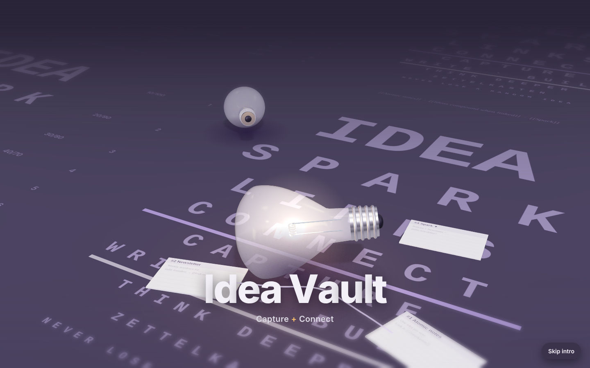
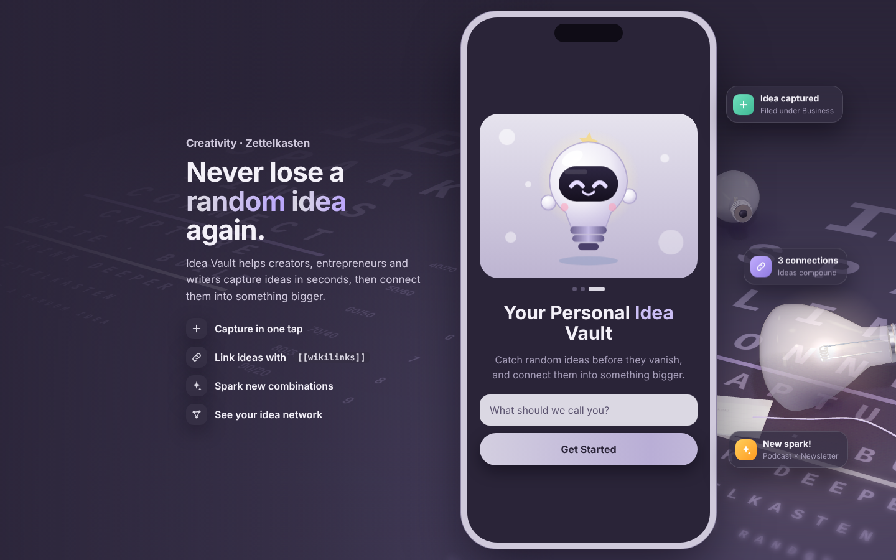
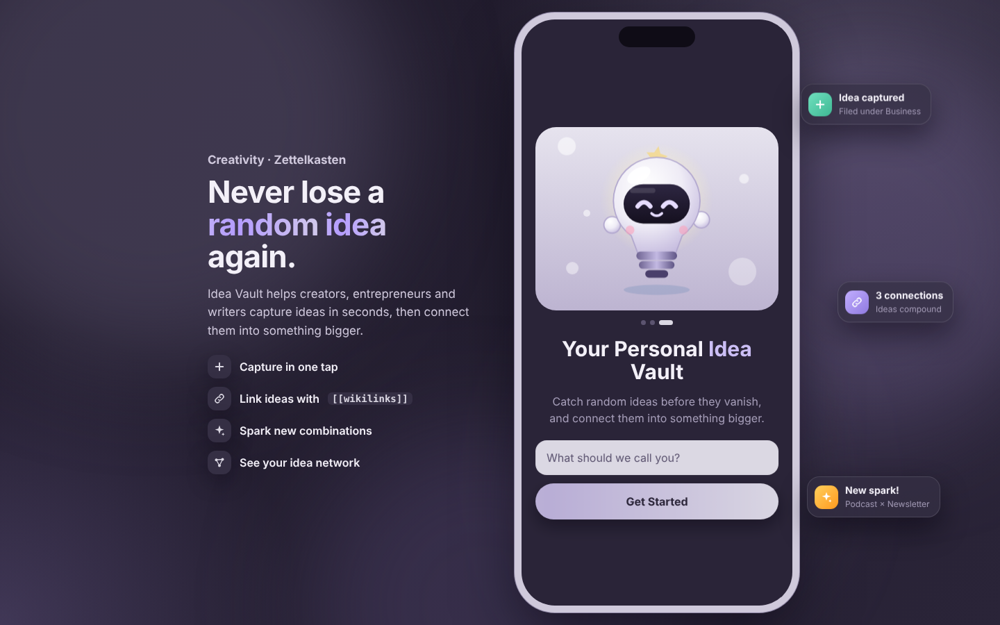
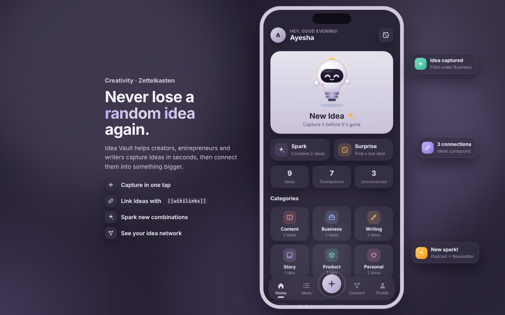
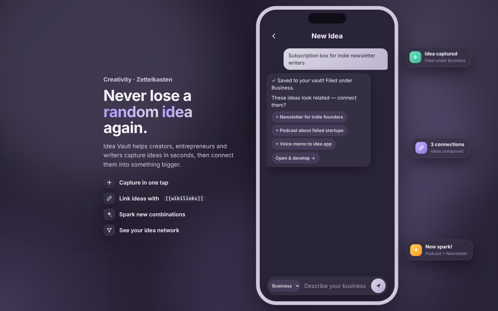
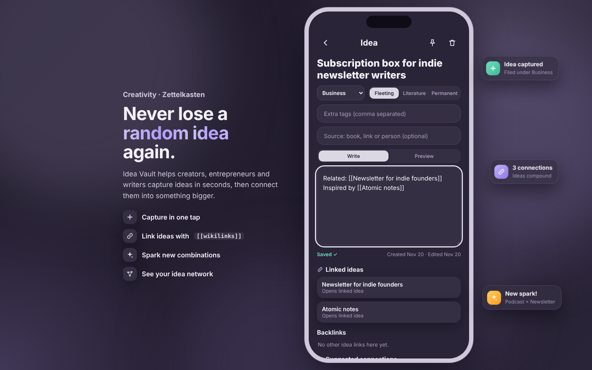
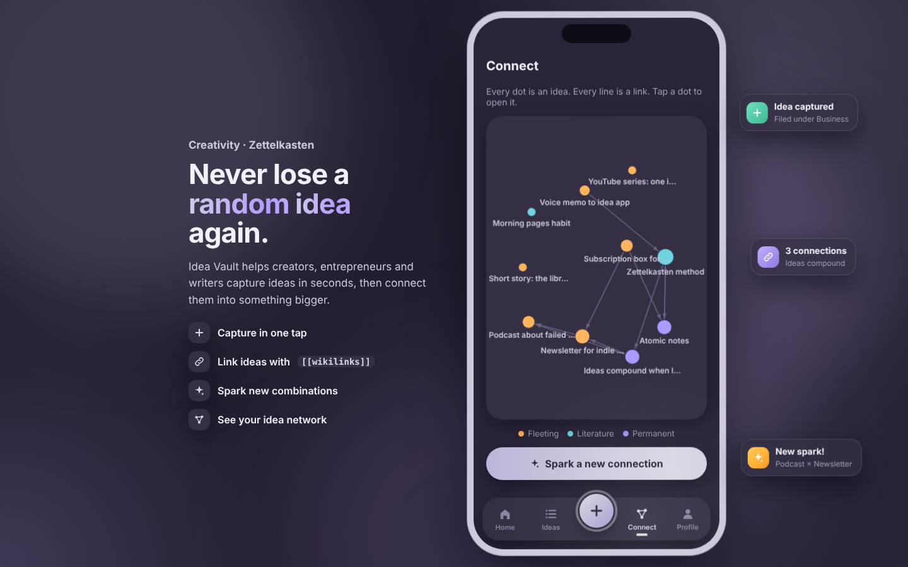
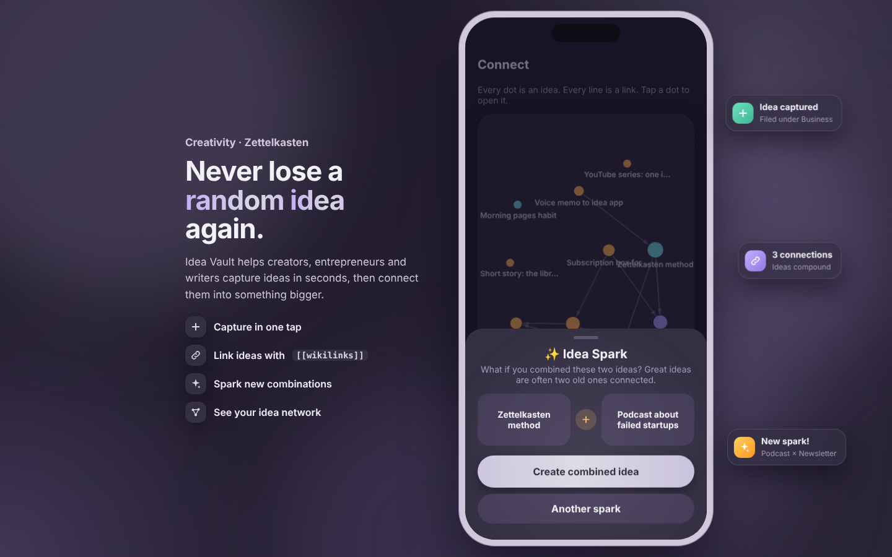

# 💡 Idea Vault

**Capture random ideas before they're lost, then connect them Zettelkasten-style.**

| | |
|---|---|
| **Domain** | Creativity / Personal Knowledge Management |
| **Problem** | Random ideas get lost: they're scattered across notes apps, paper and chats, and saved ideas sit alone and never grow. |
| **Target users** | Creators, entrepreneurs, writers |
| **Unique factor** | **Capture + Connect.** Chat-style one-tap capture, plus `[[wikilinks]]`, automatic backlinks, connection suggestions, **Spark** (combine two ideas), an idea graph and random resurfacing of forgotten ideas (Zettelkasten method). |





---

## Features

- 🎥 **Cinematic 3D intro**: the camera glides over a giant printed "idea chart" to a glass lightbulb, the bulb lights up, and "Idea Vault" rises. The 3D scene then stays as a slowly moving background. It can be skipped, and slower computers automatically get a simple background instead.
- 💜 **Lavender night design**: dark purple screens with light lavender cards, in the palette #2A2438 · #352F44 · #5C5470 · #DBD8E3.
- 📱 **Mobile-style app**: rounded cards, a mascot ("Vaulty") and a bottom menu. It runs full-screen on phones and inside a phone frame on desktop.
- 🎬 **Motion graphics**:
  - an app launch intro
  - a 3D phone that swings in and tilts toward your mouse
  - drifting coloured lights in the background
  - floating glass badges
  - headline words that rise out of a blur
  - blur-and-zoom screen changes
  - 3D tilting cards with a glare
  - ripple effects on tap and a sliding tab marker
  - a glass header that appears when you scroll
- 🎬 **Animations**:
  - the mascot blinks, waves and floats
  - screens slide and cards pop in one by one
  - numbers count up
  - the New Idea chat shows typing dots, and saving an idea bursts confetti
  - Spark cards fly in, and buttons bounce when tapped

  All of these switch off when the device has "reduce motion" turned on.
- 👋 **Welcome screen**: the home screen greets you by name.
- ⚡ **New Idea (chat-style capture)**: tap **+**, pick a category, type your idea and tap Send.
- 🗂️ **6 categories**: Content, Business, Writing, Story, Product and Personal, each with its own icon and colour.
- 🔗 **Zettelkasten links**: write `[[Another idea]]`. Typing `[[` shows a list of matching ideas.
- ↩️ **Backlinks**: see every idea that links to the one you're reading.
- 🧩 **Suggested connections**: right after you capture an idea, and on every idea screen, with one-tap **+ Connect**.
- ✨ **Spark**: shows two unconnected ideas and asks "What if you combined these?", then creates the combined idea for you.
- 🕸️ **Connect tab**: an interactive network of your ideas.
- 🎲 **Surprise**: brings back a random idea, favouring forgotten ones.
- 🔎 **Search, category and type filters**, 📝 **Markdown preview**, 📌 pinning and autosave.
- 💾 **Export / import** the whole vault as JSON (on the Profile screen).
- 🔒 Works offline, stores data locally, and needs no accounts, API keys or paid services.

## Tech Stack

| Layer | Technology |
|---|---|
| Runtime | Node.js (20+) |
| Back end | Express 4 REST API |
| Front end | HTML5, CSS3, vanilla JavaScript, inline SVG (mascot and icons), Canvas API (graph) |
| 3D intro and background | Three.js (WebGL), bundled into `public/scene.js` with esbuild |
| Storage | Local JSON file with atomic writes |
| Testing | Node.js built-in test runner (`node:test`) |
| Docs and diagrams | Markdown, Mermaid |

Full details with screenshots: [`docs/Tools_and_Technologies/`](docs/Tools_and_Technologies/Tools_and_Technologies.md)

---

## Installation

### Prerequisites
- **Node.js 20 or newer** (includes npm): https://nodejs.org/
- **Git** (to clone the repo): https://git-scm.com/

Check them:
```bash
node -v    # v20.x or higher
npm -v
```

### Steps
```bash
# 1. Clone the repository
git clone <your-repository-url>.git
cd idea-vault

# 2. Install dependencies (only Express)
npm install

# 3. (Optional) Load 7 sample ideas to explore
npm run seed

# 4. Start the app
npm start
```
Then open **http://localhost:3000** in your browser.

## Configuration

Configuration uses environment variables, and every one is optional. See [`.env.example`](.env.example).

| Variable | Default | Purpose |
|---|---|---|
| `PORT` | `3000` | Port the server listens on |
| `HOST` | `127.0.0.1` | Address to bind (use `0.0.0.0` to allow other devices on your network) |
| `DATA_FILE` | `data/ideas.json` | Where ideas are stored |

Examples:
```bash
# macOS / Linux
PORT=4000 npm start

# Windows PowerShell
$env:PORT=4000; npm start

# Windows Command Prompt
set PORT=4000 && npm start
```
No API keys, passwords or secrets are needed.

## Running

| Command | What it does |
|---|---|
| `npm start` | Start the server at http://localhost:3000 |
| `npm run dev` | Start with auto-restart on file changes |
| `npm run seed` | Add sample ideas (skips any that already exist) |
| `npm test` | Run the automated test suite (18 tests) |
| `npm run build:scene` | Rebuild the 3D intro bundle (`client/scene.js` → `public/scene.js`). This is only needed if you change the 3D scene; the built file is already included. |

## How to Use

1. **Welcome**: type your name and tap **Get Started**.
2. **Capture**: tap the big **+** (or the "New Idea" card), choose a prompt such as "Business idea", type your idea and tap Send.
3. **Connect right away**: the reply shows related ideas. Tap **+ name** to link them.
4. **Develop**: tap **Open & develop** to add details, a type and a source. Type `[[` to link another idea. Changes save automatically.
5. **Explore**:
   - **My Ideas** lets you search and filter your ideas.
   - **Connect** shows the network of all your ideas.
   - **Spark** suggests combining two ideas.
   - **Surprise** brings back a random old idea.
6. **Back up**: go to **Profile**, then **Export vault**. Use **Import vault** to restore.

On desktop you can also use these shortcuts: `N` new idea · `/` search · `Ctrl/Cmd + S` save · `Esc` close.

## REST API

Base URL: `http://localhost:3000/api`

| Method | Endpoint | Description |
|---|---|---|
| GET | `/ideas?q=&tag=&type=&sort=` | List / search ideas |
| POST | `/ideas` | Create an idea `{title, body?, type?, tags?, source?, pinned?}` |
| GET | `/ideas/:id` | Idea with `outgoing`, `backlinks`, `suggestions` |
| PUT | `/ideas/:id` | Update an idea (partial) |
| DELETE | `/ideas/:id` | Delete an idea |
| GET | `/tags` · `/graph` · `/stats` · `/random` · `/spark` | Tags, network, totals, random idea, idea pair to combine |
| GET / POST | `/export` · `/import` | Back up / restore |
| GET | `/health` | Health check |

Example:
```bash
curl -X POST http://localhost:3000/api/ideas \
  -H "Content-Type: application/json" \
  -d '{"title":"Podcast about failed startups","tags":["business"]}'
```

## Testing

```bash
npm test
```
18 automated tests cover CRUD, validation, wikilinks/backlinks, renaming, suggestions, search and filters, random, Spark, export/import, statistics, persistence and security headers. The test plan and results are in the [SRS, Section 9](docs/SRS/IdeaVault_SRS.md#9-testing-and-verification).

## Repository Structure

```
idea-vault/
├── README.md                     ← you are here
├── Paid_Tools_Links.txt          ← paid / premium tools disclosure
├── package.json                  ← scripts and dependencies
├── .env.example                  ← optional configuration
├── src/                          ← back end (Node.js + Express)
│   ├── server.js                 ← entry point
│   ├── app.js                    ← routes, security headers, error handling
│   ├── store.js                  ← data, links, backlinks, suggestions, graph
│   ├── links.js                  ← [[wikilink]] parsing helpers
│   └── seed.js                   ← sample data
├── client/                       ← source of the 3D intro (Three.js)
├── public/                       ← front end (HTML, CSS, JS, SVG mascot, motion.js, scene.js)
├── tests/                        ← automated tests
├── data/                         ← your ideas.json (git-ignored)
├── screenshots/                  ← application screenshots
└── docs/
    ├── SRS/                      ← SRS (Markdown + PDF) and diagrams
    ├── UML/                      ← system models by Ayesha Shafiq (9) + explanation (Markdown + PDF)
    ├── Risk_Management/          ← risk management plan + risk matrix (Markdown + PDF)
    └── Tools_and_Technologies/   ← tools documentation + screenshots
```

## Documentation

- 📄 **SRS**: [Markdown](docs/SRS/IdeaVault_SRS.md) · [PDF](docs/SRS/IdeaVault_SRS.pdf)
- 📐 **System models and UML diagrams** by Ayesha Shafiq (system context, use case, sequence, 2 data flow diagrams, 2 state machines, class diagram, MDA model): [Explanation](docs/UML/UML_Diagrams.md) · [PDF](docs/UML/UML_Diagrams.pdf) · [Original](docs/UML/Ayesha_Shafiq_Idea_Vault_Models.pdf)
- 📊 **Implementation architecture** diagram: [`docs/SRS/diagrams/`](docs/SRS/diagrams/)
- ⚠️ **Risk management plan** (14 risks, risk matrix, RMMM): [Markdown](docs/Risk_Management/Risk_Management_Plan.md) · [PDF](docs/Risk_Management/Risk_Management_Plan.pdf)
- 🛠️ **Tools and technologies**: [`docs/Tools_and_Technologies/`](docs/Tools_and_Technologies/Tools_and_Technologies.md)
- 💳 **Paid tools**: [`Paid_Tools_Links.txt`](Paid_Tools_Links.txt)

## Screenshots

| 3D intro | Desktop |
|---|---|
|  |  |

| Welcome | Home | New Idea |
|---|---|---|
|  |  |  |
| **Idea** | **Connect** | **Spark** |
|  |  |  |

More in [`screenshots/`](screenshots/).

## Troubleshooting

| Problem | Fix |
|---|---|
| `EADDRINUSE: address already in use :::3000` | Another app is using port 3000. Run with `PORT=4000 npm start`. |
| `'node' is not recognized` | Install Node.js 20+ and reopen the terminal. |
| Page can't be reached from your phone | Start with `HOST=0.0.0.0` and open `http://<computer-ip>:3000`. |
| Want to start fresh | Stop the server and delete `data/ideas.json`. |
| Want to see the 3D intro again | It plays once per browser tab, so open the app in a new tab. |
| No 3D intro, only a gradient background | Your computer has no 3D graphics card (or "reduce motion" is on). This is on purpose, so the app stays fast. |

## Authors

| Name | Roll number |
|---|---|
| Ayesha Shafiq | F25CSC068 |
| Saveez Ali | F25CSC020 |

**Course:** Software Engineering  
**Course instructor:** Sir Umer

## License

MIT
