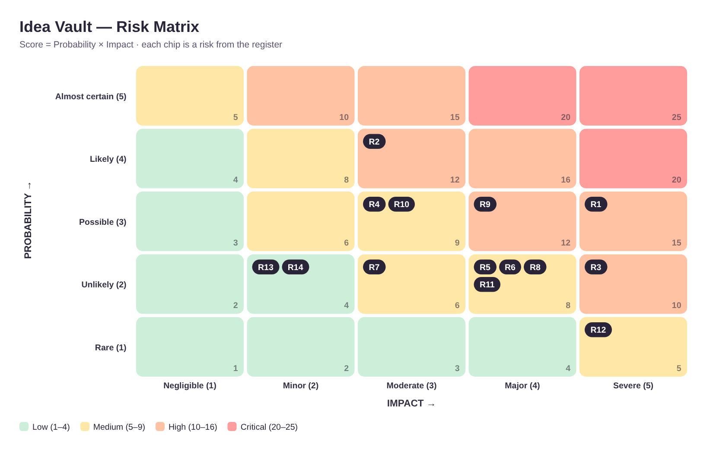

# Risk Management Plan — Idea Vault

| Item | Details |
|---|---|
| Project | Idea Vault: capture and connect ideas (Zettelkasten) |
| Prepared by | Ayesha Shafiq (F25CSC068) and Saveez Ali (F25CSC020) |
| Course | Software Engineering |
| Course instructor | Sir Umer |
| Version | 1.0 (Final) · 20 November 2026 |

---

## 1. Purpose

This plan identifies what could go wrong in the Idea Vault project, how likely and how serious each problem is, and what the team does to **prevent** it (mitigation), **watch** for it (monitoring) and **handle** it if it happens (contingency). It follows the **RMMM** approach: Risk Mitigation, Monitoring and Management.

## 2. Team Roles and Risk Owners

| Member | Main responsibilities | Owns risks in these areas |
|---|---|---|
| **Ayesha Shafiq** (F25CSC068) | Front end (screens, design, animations, 3D intro), documentation (SRS, UML) | Scope, usability, requirements, front-end performance |
| **Saveez Ali** (F25CSC020) | Back end (Express API, data storage), testing, setup and deployment | Data, security, dependencies, deployment |
| **Both** | Planning, reviews, final submission | Schedule, team, academic integrity, backups |

## 3. Risk Management Process

1. **Identify:** list risks at the start and whenever the plan or design changes.
2. **Analyse:** rate each risk's **probability** (1–5) and **impact** (1–5). Score = probability × impact.
3. **Plan:** write a mitigation (prevent or reduce) and a contingency (what to do if it happens) for each risk.
4. **Monitor:** check the warning signs at every milestone and after every design change. Update the register.
5. **Close:** mark a risk *Mitigated*, *Accepted* or *Closed* when it is under control.

### Rating scales

| Score | Probability | Impact |
|---|---|---|
| 1 | Rare (< 10%) | Negligible: no visible effect |
| 2 | Unlikely (10–30%) | Minor: small delay or cosmetic issue |
| 3 | Possible (30–50%) | Moderate: a feature is degraded or the project slips a few days |
| 4 | Likely (50–80%) | Major: a key feature fails or marks are lost |
| 5 | Almost certain (> 80%) | Severe: data loss, a failed demo or a missed submission |

**Risk level:** Low 1–4 · Medium 5–9 · High 10–16 · Critical 20–25.

## 4. Risk Register

| ID | Risk | Category | P | I | Score | Level | Mitigation (prevent / reduce) | Contingency (if it happens) | Owner | Status |
|---|---|---|---|---|---|---|---|---|---|---|
| R1 | Missing the submission deadline | Schedule | 3 | 5 | 15 | High | Milestones; submission checklist; core features done first; documents updated in one final pass | Submit the working core and the documents; leave out optional extras | Both | Mitigated |
| R2 | Scope creep from repeated design changes (redesign, animations, 3D intro, new colours) | Scope | 4 | 3 | 12 | High | Each change request is tested before the next one; rule "change the app first, update the documents after"; a demo link to approve each change | Go back to the last stable version | Ayesha | Occurred, controlled |
| R3 | Idea data lost or corrupted (crash during save) | Technical | 2 | 5 | 10 | High | Atomic writes (temporary file, then rename); server-side validation; JSON export backup | Restore from the last export (Import) | Saveez | Mitigated |
| R4 | 3D intro too slow or unsupported on some computers | Performance | 3 | 3 | 9 | Medium | GPU detection; slow-frame fallback; Skip button; 15-second safety timer; 30 fps cap; 3D stops on phones | Show the gradient background instead of 3D | Ayesha | Occurred, mitigated |
| R5 | Security: script injection (XSS) through idea text | Security | 2 | 4 | 8 | Medium | HTML-escape all text; strict Content Security Policy (self only); server input validation | Patch, re-test, release a fix | Saveez | Mitigated |
| R6 | A team member becomes unavailable (illness, exams) | People | 2 | 4 | 8 | Medium | Shared GitHub repo; README and SRS explain the whole system; both members can run the project | The other member takes over, using the documents | Both | Monitored |
| R7 | A third-party library breaks or has a vulnerability (Express, Three.js) | Technical | 2 | 3 | 6 | Medium | Versions pinned in `package-lock.json`; `npm audit` shows 0 vulnerabilities; only one runtime dependency | Roll back to the previous version | Saveez | Mitigated |
| R8 | Misunderstanding the instructor's requirements | Requirements | 2 | 4 | 8 | Medium | `SUBMISSION_CHECKLIST.md` maps every requirement to a file; requirements traceability matrix in the SRS | Fill gaps before the deadline | Ayesha | Mitigated |
| R9 | App fails to run on the instructor's computer (Node.js missing, port in use) | Deployment | 3 | 4 | 12 | High | Step-by-step README; troubleshooting table; `PORT` setting; standalone demo HTML file; online demo link | Present the standalone demo or online demo | Saveez | Mitigated |
| R10 | Users find Zettelkasten linking confusing | Usability | 3 | 3 | 9 | Medium | `[[` autocomplete; suggested connections with one-tap Connect; welcome screen; helpful empty states | Add a short tutorial or tooltips | Ayesha | Mitigated |
| R11 | Over-reliance on an AI assistant / academic integrity | Ethics | 2 | 4 | 8 | Medium | AI use disclosed in `Paid_Tools_Links.txt`; the team runs, tests and reviews all code and can explain it | Rewrite or simplify any part the team cannot explain | Both | Monitored |
| R12 | Source code lost (laptop failure) | Technical | 1 | 5 | 5 | Medium | GitHub remote repository; zip backups | Restore from GitHub or a backup | Both | Mitigated |
| R13 | Animations cause discomfort or accessibility problems | Usability | 2 | 2 | 4 | Low | Short animations (< 1 s); all motion off when "reduce motion" is set | Switch animations off | Ayesha | Mitigated |
| R14 | A single JSON file limits very large vaults | Scalability | 2 | 2 | 4 | Low | Size limits per idea; personal-scale use (a few thousand ideas); database planned as future work | Move to SQLite | Saveez | Accepted |

*P = probability, I = impact.*

## 5. Risk Matrix

**Summary:** 4 High, 8 Medium and 2 Low risks; none are Critical. The high risks are the deadline (R1), scope creep (R2), data loss (R3) and setup on the instructor's computer (R9). These four get the detailed RMMM plans below.

## 6. Detailed RMMM for the High Risks

### R1: Missing the submission deadline
- **Mitigation:** build core features first (capture, link, backlinks, search); work from the submission checklist; update the documents in one pass once the app is final.
- **Monitoring:** at each milestone, compare finished checklist items with the days left. Warning sign: two or more checklist items still open in the final week.
- **Management:** freeze new features, submit what works, and list the remaining ideas as future enhancements.

### R2: Scope creep from design changes
- **Mitigation:** treat each change as a small change request; test and show it on the demo link before starting the next; update the documents only after the app is approved.
- **Monitoring:** count design changes per week and re-run the automated tests (18) and the UI check after each one. Warning sign: a change breaks an existing screen.
- **Management:** revert to the last stable version and re-apply the change in smaller steps.

### R3: Data loss or corruption
- **Mitigation:** atomic file writes; strict validation (title, length, type, tags); JSON export.
- **Monitoring:** the automated test "data persists to the JSON file across restarts"; server error logs.
- **Management:** stop the server, restore `data/ideas.json` from the latest export with Import, and check with `npm test`.

### R9: App fails to run on the instructor's computer
- **Mitigation:** README with install, configure and run steps; troubleshooting table; configurable `PORT` and `HOST`; one runtime dependency; `public/scene.js` already built, so no build step is needed.
- **Monitoring:** before submitting, install from the zip on a clean folder (`npm install`, `npm test`, `npm start`).
- **Management:** use the standalone `Idea-Vault-Demo.html` file or the online demo link, and show the code and tests from GitHub.

## 7. Risk Monitoring Log

| When | Risk | What happened | Action taken | Result |
|---|---|---|---|---|
| Design phase | R2 | The interface was redesigned several times: mobile-style screens, then animations, motion graphics, a 3D intro and a new colour theme | Each change tested with automated UI checks before the next; documents updated once at the end | Controlled: all 18 tests pass and documents match the final app |
| Testing the 3D intro | R4 | On a computer without a graphics card, the 3D intro was very slow and hid the app for about 12 seconds | Added software-graphics detection before building the scene, a slow-frame fallback and a 15-second safety timer | Mitigated: the app now appears instantly on such computers |
| Testing the motion layer | R10 / R13 | A new 3D wrapper collapsed the app on phone-sized screens | Fixed the layout and added a phone-size test and a reduced-motion test | Mitigated |
| Final packaging | R9 | Risk that setup fails on another computer | Fresh install from the zip: `npm install`, `npm test` (18/18 pass) and a server start-up test | Mitigated |

## 8. Review Schedule

The register is reviewed **at every milestone** (requirements, design, implementation, testing, submission) and **after every design change request**. Any new risk is added with an ID, a rating, an owner and both plans.
