# Software Requirements Specification (SRS)

## Idea Vault — Capture and Connect Your Ideas

| Item | Details |
|---|---|
| Project name | Idea Vault |
| Domain | Creativity / Personal Knowledge Management |
| Document version | 3.0 (Final: lavender theme + 3D intro) |
| Date | 20 November 2026 |
| Prepared by | Ayesha Shafiq (F25CSC068) and Saveez Ali (F25CSC020) |
| Course | Software Engineering |
| Course instructor | Sir Umer |
| Repository | GitHub repository link submitted through the LMS |

---

## Table of Contents

1. [Introduction](#1-introduction)
2. [Overall Description](#2-overall-description)
3. [System Features and Functional Requirements](#3-system-features-and-functional-requirements)
4. [External Interface Requirements](#4-external-interface-requirements)
5. [Non-Functional Requirements](#5-non-functional-requirements)
6. [User Stories and Acceptance Criteria](#6-user-stories-and-acceptance-criteria)
7. [System Models and UML Diagrams](#7-system-models-and-uml-diagrams)
8. [Data Dictionary](#8-data-dictionary)
9. [Testing and Verification](#9-testing-and-verification)
10. [Requirements Traceability Matrix](#10-requirements-traceability-matrix)
11. [Risk Management](#11-risk-management)
12. [Future Enhancements](#12-future-enhancements)
13. [Appendices](#13-appendices)

---

## 1. Introduction

### 1.1 Purpose

This document specifies the software requirements for **Idea Vault**, a web application that lets creative people capture random ideas the moment they occur and connect them into a network of linked notes using the **Zettelkasten** method. It is intended for the course instructor (evaluator), the developer, and anyone who will test, maintain or extend the system. It describes what the system does, the constraints it works under, and how each requirement is verified.

### 1.2 Problem Statement

Creative people have ideas at random moments — in the shower, on a walk, while reading. These ideas are typically scattered across phone notes, paper, chat messages and email drafts. As a result:

- **Ideas get lost.** Most are never found again once the moment passes.
- **Ideas stay isolated.** Even when saved, a note sits alone in a list; there is nothing that brings it back into contact with related thoughts, so it never grows into a project.
- **Capturing is slow.** Heavy tools that ask for folders, templates and formatting at capture time discourage people from writing ideas down at all.

### 1.3 Proposed Solution and Unique Factor

Idea Vault solves this with two steps: **Capture + Connect**.

1. **Capture** — a big **+** button (always on the bottom menu) opens a chat-style "New Idea" screen. The user types the idea, optionally picks a category, and taps Send. No folders or formatting are needed.
2. **Connect (Zettelkasten)** — ideas link to each other by writing `[[Idea Title]]`. The system automatically builds **backlinks**, draws an **interactive idea graph**, **suggests connections** right after an idea is captured, **sparks** new ideas by pairing two unconnected ideas, and **resurfaces** forgotten ("orphan") ideas at random.

The unique factor compared with ordinary note apps is that the value lies in the **connections between ideas**, not in the pile of notes; the system actively helps the user build and rediscover those connections.

### 1.4 Intended Audience

| Reader | Sections of most interest |
|---|---|
| Instructor / evaluator | All, especially 3, 5, 6, 9, 10 |
| Developer / maintainer | 2.5, 3, 4, 7, 8 |
| Tester | 3, 6, 9, 10 |
| End users (creators, entrepreneurs, writers) | 1, 2 and the project README |

### 1.5 Scope

**In scope (version 1.0):**

- A friendly, mobile-style interface (works on phones and in a phone-shaped frame on desktop) with a mascot, welcome screen, home dashboard and bottom navigation.
- Chat-style quick capture of ideas into six categories (Content, Business, Writing, Story, Product, Personal); editing title, body (Markdown), category, type, extra tags, source and pin status.
- Zettelkasten linking using `[[wikilinks]]`, with autocomplete while typing.
- Automatic outgoing links, backlinks and "missing link" detection (links to ideas not yet written).
- Automatic update of links when an idea is renamed.
- Connection suggestions based on shared tags and unlinked mentions.
- Full-text search, tag filter, type filter and sorting.
- Interactive force-directed graph of the idea network.
- "Surprise me" random resurfacing that favours unconnected ideas.
- "Spark": pairs two unconnected ideas and offers to create a combined idea.
- A cinematic 3D intro (a lightbulb lighting up on a printed "idea chart") and a living 3D background, with automatic fallbacks for slower devices.
- Vault statistics (ideas, links, unconnected ideas).
- Export of the whole vault to JSON and import from JSON.
- Local, single-user use through a web browser.

**Out of scope (version 1.0):** user accounts and multi-user sharing, cloud sync, mobile native apps, real-time collaboration, AI features, attachments/images inside ideas. These are listed in Section 11 as future enhancements.

### 1.6 Definitions, Acronyms and Abbreviations

| Term | Meaning |
|---|---|
| **Zettelkasten** | "Slip box" — a note-taking method (popularised by sociologist Niklas Luhmann) in which each note holds one idea and notes are linked to each other. |
| **Idea / Note** | One unit of thought stored in Idea Vault. |
| **Wikilink** | A link written as `[[Idea Title]]` inside an idea's body. |
| **Outgoing link** | A wikilink from the current idea to another idea. |
| **Backlink** | A link *to* the current idea from another idea. |
| **Missing link** | A wikilink to a title that does not exist yet. |
| **Orphan idea** | An idea with no outgoing or incoming links. |
| **Category** | One of six built-in tags (content, business, writing, story, product, personal) shown with its own icon and colour. |
| **Spark** | A suggestion that pairs two unconnected ideas to inspire a new, combined idea. |
| **Vaulty** | The app's original mascot, a friendly lightbulb robot drawn in SVG. |
| **Fleeting idea** | A quick, raw capture. |
| **Literature idea** | An idea taken from a source (book, article, person). |
| **Permanent idea** | A refined idea written in the user's own words and linked into the network. |
| API | Application Programming Interface |
| REST | Representational State Transfer |
| JSON | JavaScript Object Notation |
| CRUD | Create, Read, Update, Delete |
| UI | User Interface |
| SRS | Software Requirements Specification |
| FR / NFR | Functional / Non-Functional Requirement |
| CSP | Content Security Policy |

### 1.7 References

1. IEEE Std 830-1998 / ISO/IEC/IEEE 29148:2018 — Recommended practice for software requirements specifications.
2. Sönke Ahrens, *How to Take Smart Notes* (2017) — Zettelkasten method.
3. Express.js documentation — https://expressjs.com/
4. Node.js documentation (test runner, fs, crypto) — https://nodejs.org/docs/
5. Mermaid diagram syntax — https://mermaid.js.org/

### 1.8 Document Overview

Section 2 gives the overall product perspective, users and constraints. Section 3 lists the functional requirements grouped by feature. Section 4 covers interfaces including the REST API. Section 5 covers quality attributes. Section 6 gives user stories with acceptance criteria. Section 7 contains the diagrams. Sections 8–10 give the data dictionary, testing approach and traceability.

---

## 2. Overall Description

### 2.1 Product Perspective

Idea Vault is a new, self-contained web application. It follows a three-tier architecture:

- **Client tier:** a single-page, mobile-style interface written in HTML, CSS, SVG and plain JavaScript that runs in any modern browser (full-screen on phones; inside a phone frame on desktop), plus a WebGL 3D intro and background built with Three.js.
- **Application tier:** a Node.js server built with Express that exposes a REST API and serves the interface.
- **Data tier:** a single JSON file (`data/ideas.json`) written atomically.

The application runs locally on the user's computer (`http://localhost:3000`) and needs no internet connection, external database or paid service. See the architecture diagram in Section 7.2.

### 2.2 Product Functions (Summary)

- Welcome the user by name and show a home dashboard.
- Capture an idea in one step, in a category.
- Develop the idea with Markdown, tags, type and source.
- Link ideas with `[[wikilinks]]` (with autocomplete).
- See outgoing links, backlinks and suggested connections for each idea.
- Search, filter and sort the vault.
- Explore the idea network as a graph.
- Resurface a random, often forgotten, idea.
- Spark a new idea by combining two unconnected ideas.
- Export and import the vault.

### 2.3 User Classes and Characteristics

| User class | Description | Key needs |
|---|---|---|
| **Creators** (YouTubers, designers, podcasters, artists) | Generate many content ideas; moderate technical skill. | Fast capture, tags by theme, rediscovering old ideas. |
| **Entrepreneurs** | Collect business, product and marketing ideas. | Connecting related ideas into larger opportunities; pinning priorities. |
| **Writers** (novelists, bloggers, students) | Collect plot fragments, characters, research notes. | Linking notes, recording sources (literature notes), Markdown. |

All users are assumed to be comfortable using a web browser. No programming knowledge is needed to use the app; basic command-line use is needed only to install and start it.

### 2.4 Operating Environment

| Component | Requirement |
|---|---|
| Server runtime | Node.js 20 LTS or newer (tested on Node.js 22) |
| Operating system | Windows 10/11, macOS 12+, or Linux |
| Browser | Current Chrome, Edge, Firefox or Safari |
| Disk | < 50 MB including dependencies |
| Network | None required after `npm install` |

### 2.5 Design and Implementation Constraints

- **C-1** The back end must be implemented in JavaScript on Node.js with the Express framework.
- **C-2** Data must be stored locally in a human-readable JSON file; no external database server.
- **C-3** The front end must not load any external (CDN) scripts, fonts or styles, so it works offline and satisfies a strict Content Security Policy. The Three.js 3D library is therefore bundled into the project's own file `public/scene.js` with esbuild.
- **C-4** No secrets, API keys or passwords are required or stored.
- **C-5** Only one server runtime dependency (Express) to keep installation simple. Three.js and esbuild are development dependencies used only to build `public/scene.js`, which is already included, so no build step is needed to run the app.

### 2.6 Assumptions and Dependencies

- **A-1** The app is used by one person on their own computer (single-user).
- **A-2** Idea titles are unique (case-insensitive) because wikilinks refer to ideas by title.
- **A-3** The user has Node.js and npm installed.
- **A-4** The vault size is personal-scale (up to a few thousand ideas).

---

## 3. System Features and Functional Requirements

Priority: **H** = High (must have), **M** = Medium (should have), **L** = Low (nice to have).

### 3.1 Idea Capture (F1)

*Description:* lets the user save an idea instantly, before it is forgotten, through a chat-style "New Idea" screen.

| ID | Requirement | Priority |
|---|---|---|
| FR-1.1 | The system shall show a central **+** button in the bottom navigation and a "New Idea" card on the home screen, both opening the New Idea screen. | H |
| FR-1.2 | The New Idea screen shall show the mascot, the question "What's on your mind today?", four prompt cards (Video or post idea, Business idea, Blog or article, Story plot) and a message box with a category selector and Send button. | H |
| FR-1.3 | Choosing a prompt card shall pre-select its category and focus the message box. | M |
| FR-1.4 | On Send, the system shall create a *fleeting* idea whose title is the first line of the text (long text, over 90 characters, is also kept as the body) and whose first tag is the chosen category. | H |
| FR-1.5 | After saving, the system shall reply in the conversation with a confirmation, up to 3 related ideas with one-tap **+ Connect** buttons, and an **Open & develop** button. | H |
| FR-1.6 | The system shall reject an empty idea and a title that duplicates an existing title (case-insensitive), replying with a clear message. | H |
| FR-1.7 | Pressing `N` (when not typing) shall open the New Idea screen on desktop. | L |

### 3.2 Idea Management (F2)

| ID | Requirement | Priority |
|---|---|---|
| FR-2.1 | The system shall let the user edit an idea's title, body, category, type (fleeting / literature / permanent, as a segmented control), extra tags, source and pinned status. | H |
| FR-2.2 | The system shall save changes automatically 1.2 seconds after the user stops typing, when leaving the screen, and on `Ctrl+S`. | H |
| FR-2.3 | The system shall display "Saving…" / "Saved ✓" status. | M |
| FR-2.4 | The system shall record creation and last-updated timestamps for each idea. | M |
| FR-2.5 | The system shall let the user delete an idea after confirming in a bottom sheet ("Delete this idea?" with Delete / Cancel). | H |
| FR-2.6 | The system shall render the body as Markdown (headings, lists, bold, italic, code) in a Preview tab. | M |
| FR-2.7 | The system shall normalise tags (lower-case, remove leading `#`, spaces become `-`, remove duplicates). | M |
| FR-2.8 | Pinned ideas shall always appear at the top of the idea list. | L |
| FR-2.9 | The system shall warn the user before leaving the page with unsaved changes. | M |

### 3.3 Zettelkasten Linking (F3)

| ID | Requirement | Priority |
|---|---|---|
| FR-3.1 | The system shall treat any text of the form `[[Title]]` in an idea's body as a link to the idea with that title. | H |
| FR-3.2 | When the user types `[[`, the system shall show an autocomplete list of matching idea titles plus a "New idea" option; arrow keys, Enter/Tab and Escape shall work. | H |
| FR-3.3 | For the open idea, the system shall list all outgoing links, marking links to non-existent ideas as *missing* and offering a **Create** button. | H |
| FR-3.4 | For the open idea, the system shall list all backlinks (ideas that link to it). | H |
| FR-3.5 | In Preview, tapping a wikilink shall open the linked idea, or create it if it is missing. | M |
| FR-3.6 | When an idea is renamed, the system shall rewrite every `[[Old Title]]` in other ideas to `[[New Title]]` so no links break. | H |

### 3.4 Connection Suggestions (F4)

| ID | Requirement | Priority |
|---|---|---|
| FR-4.1 | The system shall suggest up to 5 ideas that are not yet linked to the open idea. | H |
| FR-4.2 | Suggestions shall be scored: +2 per shared tag; +3 if the other idea mentions this idea's title without linking; +3 if this idea mentions the other's title without linking. | M |
| FR-4.3 | Each suggestion shall show the reason (e.g., "shares tag #writing"). | M |
| FR-4.4 | A **+ Connect** button shall append `Related: [[Title]]` to the body and save. | H |

### 3.5 Search, Filter and Sort (F5)

| ID | Requirement | Priority |
|---|---|---|
| FR-5.1 | The "My Ideas" screen shall search titles, bodies, tags and sources; all search words must match (AND), case-insensitive. | H |
| FR-5.2 | The system shall show category chips (All + 6 categories) to filter the list; tapping a category tile on the home screen opens My Ideas filtered by it. | H |
| FR-5.3 | The system shall filter by idea type (All / Fleeting / Literature / Permanent). | M |
| FR-5.4 | Lists shall show pinned ideas first, then the most recently updated; the API also supports sorting by creation date or title. | M |
| FR-5.5 | Each idea card shall show its category icon, type colour dot, a text preview and its number of connections. | M |

### 3.6 Idea Graph (F6)

| ID | Requirement | Priority |
|---|---|---|
| FR-6.1 | The **Connect** tab shall show an interactive force-directed graph where nodes are ideas and arrows are links. | H |
| FR-6.2 | Node colour shall show the idea type; node size shall grow with the number of connections. | M |
| FR-6.3 | Tapping a node shall open that idea; nodes can be dragged. | M |
| FR-6.4 | The Connect screen shall offer a "Spark a new connection" button (see FR-7.3). | L |

### 3.7 Resurfacing and Statistics (F7)

| ID | Requirement | Priority |
|---|---|---|
| FR-7.1 | "Surprise" (home screen) shall open a random idea, preferring orphan ideas (60% chance when orphans exist). | H |
| FR-7.2 | The home and profile screens shall show the total number of ideas, connections and unconnected ideas. | M |
| FR-7.3 | "Spark" shall pick two ideas that are not linked to each other (3× more likely when they share no tags) and show them in a bottom sheet asking "What if you combined these?". | H |
| FR-7.4 | "Create combined idea" shall create a new fleeting idea titled "A × B", tagged with both ideas' tags and linking to both; "Another spark" shall show a new pair. | M |
| FR-7.5 | When fewer than two unlinked ideas exist, Spark shall show the message "Add at least two unconnected ideas to get a spark". | M |

### 3.8 Export and Import (F8)

| ID | Requirement | Priority |
|---|---|---|
| FR-8.1 | From the Profile screen, the system shall export all ideas to a downloadable JSON file named `idea-vault-YYYY-MM-DD.json`. | H |
| FR-8.2 | The system shall import ideas from such a file, skipping ideas whose titles already exist or that are invalid, and report how many were imported and skipped. | M |
| FR-8.3 | The system shall reject an import file that has no `ideas` array. | M |

### 3.9 Onboarding and Profile (F9)

| ID | Requirement | Priority |
|---|---|---|
| FR-9.1 | On first use, the system shall show a welcome screen with the mascot, the title "Your Personal Idea Vault", a short description, a name field and a **Get Started** button. | M |
| FR-9.2 | The home screen shall greet the user by name with a time-of-day greeting (good morning / afternoon / evening) and an initial-letter avatar. | L |
| FR-9.3 | The Profile screen shall let the user change their name, see statistics, export/import the vault and view the welcome screen again. | M |
| FR-9.4 | The display name shall be stored only in the user's browser (local storage); if storage is unavailable the app shall still work. | L |

### 3.10 Cinematic 3D Intro and Background (F10)

| ID | Requirement | Priority |
|---|---|---|
| FR-10.1 | On first opening in a browser tab, the system shall play a 3D intro (about 3.5 s): the camera glides over a printed "idea chart" (IDEA, SPARK, LINKS, CONNECT…) to a glass lightbulb lying among Zettelkasten index cards; the bulb flickers and lights up, the title "Idea Vault — Capture + Connect" rises letter by letter, and the app then swings in. | M |
| FR-10.2 | The user shall be able to skip the intro with a **Skip intro** button, a click, or the Esc / Enter / Space keys. | M |
| FR-10.3 | After the intro, the 3D scene shall remain as a slowly orbiting background with soft shadows, depth-of-field blur and gentle mouse parallax; on wide screens the glowing bulb shall be placed in the free space to the right of the phone. | L |
| FR-10.4 | The intro shall play only once per browser tab session. | L |
| FR-10.5 | On devices without hardware 3D graphics, with very slow first frames, or without WebGL, the system shall skip the intro and show an animated gradient background instead; with "reduce motion" on, it shall show one still frame. The app shall never be hidden for more than 15 seconds. | H |
| FR-10.6 | On phones, the 3D scene shall stop drawing once the app covers the screen, to save battery. | M |

---

## 4. External Interface Requirements

### 4.1 User Interface

The UI is designed like a modern mobile app in a "lavender night" palette — **#2A2438** (background), **#352F44** (cards), **#5C5470** (details) and **#DBD8E3** (light lavender cards, buttons and search bar) — with rounded cards, an original animated mascot ("Vaulty", a lavender lightbulb robot drawn in SVG that blinks, waves and floats) and a bottom navigation bar. On phones it fills the screen; on desktop it appears inside a phone frame beside a short product description. Screenshots are in `/screenshots`.

| Screen | Contents |
|---|---|
| Welcome | Mascot, "Your Personal Idea Vault", description, name field, Get Started |
| Home | Greeting + avatar, "New Idea" card, Spark and Surprise buttons, statistics, 6 category tiles, recent ideas |
| New Idea | Mascot, "What's on your mind today?", prompt cards, conversation, message box with category and Send |
| My Ideas | Search, category chips, type filter, idea cards |
| Idea | Title, category, type, tags, source, Write/Preview, linked ideas, backlinks, suggested connections, pin and delete |
| Connect | Idea network graph, legend, "Spark a new connection" |
| Profile | Avatar, name, statistics, Export, Import, show welcome screen |
| Bottom sheet | Spark pair; delete confirmation |

Before the app appears, a full-screen 3D intro plays once per tab (Section 3.10), and the 3D scene then stays as the page background.

Bottom navigation: Home · Ideas · **+** (New Idea) · Connect · Profile. Desktop keyboard shortcuts: `N` new idea, `/` search, `Ctrl/Cmd+S` save, `Esc` close sheet/autocomplete.

### 4.2 Software Interfaces — REST API

Base URL: `http://localhost:3000/api`. All bodies are JSON.

| Method | Endpoint | Description | Success | Errors |
|---|---|---|---|---|
| GET | `/health` | Server health check | 200 | — |
| GET | `/meta` | Allowed idea types | 200 | — |
| GET | `/ideas?q=&tag=&type=&sort=` | List / search ideas | 200 | — |
| POST | `/ideas` | Create idea | 201 | 400, 409 |
| GET | `/ideas/:id` | Idea + outgoing, backlinks, suggestions | 200 | 404 |
| PUT | `/ideas/:id` | Update (partial) | 200 | 400, 404, 409 |
| DELETE | `/ideas/:id` | Delete | 204 | 404 |
| GET | `/tags` | Tags with counts | 200 | — |
| GET | `/graph` | Nodes and edges | 200 | — |
| GET | `/stats` | Totals | 200 | — |
| GET | `/random` | Random idea | 200 | 404 (empty vault) |
| GET | `/spark` | Two unlinked ideas + prompt | 200 | 404 (fewer than 2 unlinked ideas) |
| GET | `/export` | Download all ideas | 200 | — |
| POST | `/import` | Import ideas | 200 | 400 |

Errors are returned as `{ "error": "message" }`.

### 4.3 Hardware Interfaces

None specific. Runs on any computer able to run Node.js and a modern browser.

### 4.4 Communication Interfaces

HTTP/1.1 between browser and server on `localhost` (port configurable through the `PORT` environment variable). By default the server binds to `127.0.0.1` so it is not reachable from other machines.

---

## 5. Non-Functional Requirements

### 5.1 Performance

| ID | Requirement | How verified |
|---|---|---|
| NFR-P1 | Each API request shall complete in under 200 ms for a vault of 1,000 ideas on a typical laptop. | Manual timing with browser DevTools |
| NFR-P2 | Quick capture shall take no more than 3 user actions (tap +, type, Send). | UI walkthrough |
| NFR-P3 | The UI shall load in under 2 seconds on localhost (no external resources). | DevTools network panel |

### 5.2 Reliability and Data Integrity

| ID | Requirement |
|---|---|
| NFR-R1 | Data shall be written atomically (temporary file then rename) so a crash during save cannot corrupt the vault. |
| NFR-R2 | Data shall persist across server restarts (verified by automated test). |
| NFR-R3 | Renaming an idea shall never leave broken links (FR-3.6). |
| NFR-R4 | Users shall be able to back up all data with Export (FR-8.1). |

### 5.3 Security

| ID | Requirement |
|---|---|
| NFR-S1 | All user text shall be HTML-escaped before display to prevent cross-site scripting (XSS). |
| NFR-S2 | The server shall send security headers: Content-Security-Policy (self only), X-Content-Type-Options, X-Frame-Options, Referrer-Policy; `X-Powered-By` is disabled. |
| NFR-S3 | All input shall be validated on the server (type, length, allowed values); malformed JSON returns 400. |
| NFR-S4 | The server shall bind to `127.0.0.1` by default. |
| NFR-S5 | No credentials, API keys or secrets shall be stored in the repository. |
| NFR-S6 | Internal error details shall not be exposed to the client (generic 500 message). |

### 5.4 Usability

| ID | Requirement |
|---|---|
| NFR-U1 | A first-time user shall be able to capture and link two ideas within 2 minutes without reading documentation. |
| NFR-U2 | Every main action shall be reachable within 2 taps from the home screen; touch targets shall be at least 42 px. |
| NFR-U3 | Error and success messages shall appear as short toast notifications. |
| NFR-U4 | Empty states shall explain what to do next (e.g., "Add tags to get connection suggestions"). |
| NFR-U5 | The layout shall be responsive down to 360 px wide and respect the "reduce motion" accessibility setting. |
| NFR-U6 | The visual design shall be consistent: one colour palette, rounded cards, category colours and icons used the same way on every screen. |
| NFR-U7 | The interface shall use short, friendly animations (under 1 second each) to give feedback: animated mascot, sliding screens, staggered cards, count-up statistics, a typing indicator and a confetti burst when an idea is saved, and press/hover effects. All motion shall be disabled when the user's device requests reduced motion. |
| NFR-U8 | The product shall look professional, using motion graphics in the style of modern product mockups: a cinematic 3D launch intro (Section 3.10), a 3D phone entrance with mouse tilt and glare, drifting background lights, floating glass badges, blur-and-zoom screen transitions, 3D card tilt, tap ripples and a sliding tab indicator. The intro shall be skippable at any time. |
| NFR-P4 | The 3D background shall run at no more than about 30 frames per second after the intro, pause when the tab is hidden, and stop on phones once the app covers it. |

### 5.5 Maintainability and Portability

| ID | Requirement |
|---|---|
| NFR-M1 | Code shall be modular: link parsing (`links.js`), data logic (`store.js`), HTTP layer (`app.js`), start-up (`server.js`). |
| NFR-M2 | Automated tests shall cover the API and link logic and run with `npm test`. |
| NFR-M3 | The app shall run unchanged on Windows, macOS and Linux. |
| NFR-M4 | Configuration (port, host, data file) shall come from environment variables, not code edits. |

### 5.6 Scalability (Limits)

| Limit | Value |
|---|---|
| Title length | 200 characters |
| Body length | 20,000 characters |
| Source length | 500 characters |
| Tags per idea | 20 (each ≤ 40 characters) |
| Request body | 2 MB |

---

## 6. User Stories and Acceptance Criteria

Format: *As a [user], I want [goal] so that [benefit].* Acceptance criteria use Given / When / Then.

### US-01 Quick capture *(FR-1.1–1.7)*
**As a** writer, **I want** to save an idea with one line and one tap **so that** I don't lose it while I'm in the middle of something else.

- **AC1** Given I tap **+**, when I choose "Story plot", type "A library of lost ideas" and tap Send, then a *fleeting* idea with that title and category *Story* is created and the reply says "Saved to your vault! Filed under Story."
- **AC2** Given related ideas exist in the same category, then the reply lists them with **+ Connect** buttons; tapping one links the ideas and shows a ✓.
- **AC3** Given an idea titled "Podcast" already exists, when I send "podcast", then no idea is created and the reply says I already have an idea with that name.

### US-02 Develop an idea *(FR-2.1–2.4, 2.6)*
**As a** creator, **I want** to add details, tags and a type to an idea **so that** it becomes useful later.

- **AC1** Given an idea is open, when I edit the body and stop typing for 1.2 s, then the status shows "Saved ✓" and the change is still there after reloading the page.
- **AC2** Given I choose category *Content* and enter extra tags "#Video, video, Big Ideas", when saved, then the tags are stored as `content, video, big-ideas`.
- **AC3** Given I tap Preview, then Markdown (headings, lists, bold) is shown formatted.

### US-03 Link ideas *(FR-3.1–3.3)*
**As a** writer, **I want** to link one idea to another by typing `[[` **so that** related thoughts are connected.

- **AC1** Given ideas A and B exist, when I type `[[` in A's body, then a list of titles appears; when I choose B, `[[B]]` is inserted.
- **AC2** After saving, B appears under "Linked ideas" in A, and A appears under "Backlinks" in B.
- **AC3** Given I write `[[Not written yet]]`, then it is shown as a missing link with a **Create** button that creates that idea.

### US-04 Rename safely *(FR-3.6)*
**As an** entrepreneur, **I want** links to update when I rename an idea **so that** my network never breaks.

- **AC1** Given idea B contains `[[Old name]]`, when I rename "Old name" to "New name", then B's body contains `[[New name]]` and the link still resolves.

### US-05 Discover connections *(FR-4.1–4.4)*
**As a** creator, **I want** the app to suggest related ideas I haven't linked **so that** I find combinations I would have missed.

- **AC1** Given idea A has tag `#writing` and unlinked idea B also has `#writing`, when I open A, then B appears under "Suggested connections" with reason "shares tag #writing".
- **AC2** When I tap **+ Connect** on B, then `Related: [[B]]` is added to A, A is saved, and B moves from Suggested connections to Linked ideas.
- **AC3** Ideas already linked in either direction are never suggested.

### US-06 Find ideas *(FR-5.1–5.4)*
**As a** writer, **I want** to search and filter my vault **so that** I can find an idea in seconds.

- **AC1** Given I type "dragons pricing" in search, then only ideas containing both words are listed.
- **AC2** Given I tap the *Business* category tile on Home (or the Business chip in My Ideas), then only Business ideas are listed; tapping "All" shows all ideas.
- **AC3** Given I select type "Permanent", then only permanent ideas are listed.

### US-07 See the big picture *(FR-6.1–6.4)*
**As an** entrepreneur, **I want** to see my ideas as a network **so that** I can spot clusters and isolated ideas.

- **AC1** When I open the Connect tab, then every idea is a node coloured by type and every link is an arrow.
- **AC2** When I tap a node, then that idea opens.

### US-08 Resurface forgotten ideas *(FR-7.1)*
**As a** creator, **I want** to be shown a random old idea **so that** forgotten ideas get a second chance.

- **AC1** Given the vault has ideas, when I tap "Surprise", then a random idea opens with the message "Resurfaced: [idea title]".
- **AC2** Given the vault is empty, then the message "The vault is empty" is shown.

### US-09 Back up my vault *(FR-8.1–8.3)*
**As a** user, **I want** to export and import my ideas **so that** I never lose them and can move them to another computer.

- **AC1** When I tap Export vault on the Profile screen, then a file `idea-vault-YYYY-MM-DD.json` containing all ideas downloads.
- **AC2** When I import that file into a vault that already has one of its titles, then the message reports "Imported N ideas, skipped 1".

### US-10 Remove an idea *(FR-2.5)*
**As a** user, **I want** to delete ideas I no longer need, with protection against accidents.

- **AC1** When I tap the trash icon, then a sheet asks "Delete this idea?"; tapping Delete removes it and returns to the previous screen; tapping Cancel or outside the sheet keeps it.

### US-11 Spark new ideas *(FR-7.3–7.5)*
**As an** entrepreneur, **I want** the app to suggest combining two of my unrelated ideas **so that** I discover new opportunities.

- **AC1** Given at least two unlinked ideas, when I tap Spark, then a sheet shows two ideas that are not linked to each other and asks "What if you combined these?".
- **AC2** When I tap "Create combined idea", then a new idea "A × B" is created that links to both and opens for editing.
- **AC3** Given every pair of ideas is already linked (or fewer than two ideas), then a message explains I need more unconnected ideas.

### US-12 Personal welcome *(FR-9.1–9.4)*
**As a** creator, **I want** the app to welcome me by name **so that** it feels like my personal vault.

- **AC1** Given I open the app for the first time, then the welcome screen asks my name; after Get Started, the home screen says e.g. "Hey, good afternoon! Ayesha".
- **AC2** When I change my name on the Profile screen, then the avatar and greeting use the new name.

### US-13 Cinematic first impression *(FR-10.1–10.6)*
**As a** creator, **I want** a short, beautiful intro when I open the app **so that** it feels like a professional product.

- **AC1** Given I open Idea Vault in a new tab on a laptop, then the camera glides over the idea chart to the lightbulb, the bulb lights up, "Idea Vault" rises, and the app swings in within about 4 seconds.
- **AC2** When I press Skip intro (or Esc), then the app appears immediately.
- **AC3** Given my computer has no 3D graphics card, then the app appears at once with the gradient background.

---

## 7. System Models and UML Diagrams

The system models below were drawn by **Ayesha Shafiq** (original file: [`docs/UML/Ayesha_Shafiq_Idea_Vault_Models.pdf`](../UML/Ayesha_Shafiq_Idea_Vault_Models.pdf)). A full explanation of every diagram, including which parts are built in version 1.0 and which are planned, is in [`docs/UML/UML_Diagrams.md`](../UML/UML_Diagrams.md).

> **Note:** the models show the complete design vision. Version 1.0 implements the core *Capture + Connect* features. Sign-in and cloud sync, voice capture, AI suggestions, reminders, attachments, collections and the archive state are planned future work (Section 12).

### 7.1 System Context Diagram
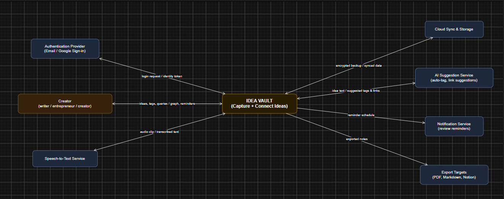

### 7.2 Use Case Diagram
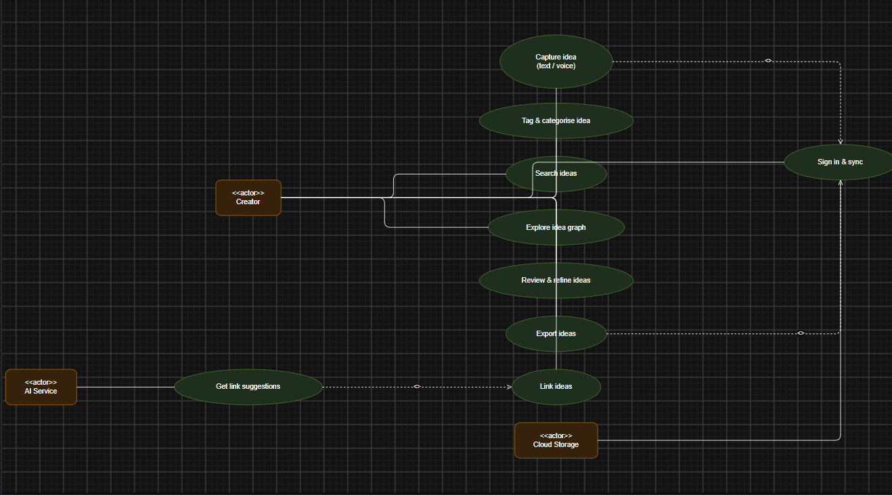

### 7.3 Sequence Diagram: Capture an Idea and Link It
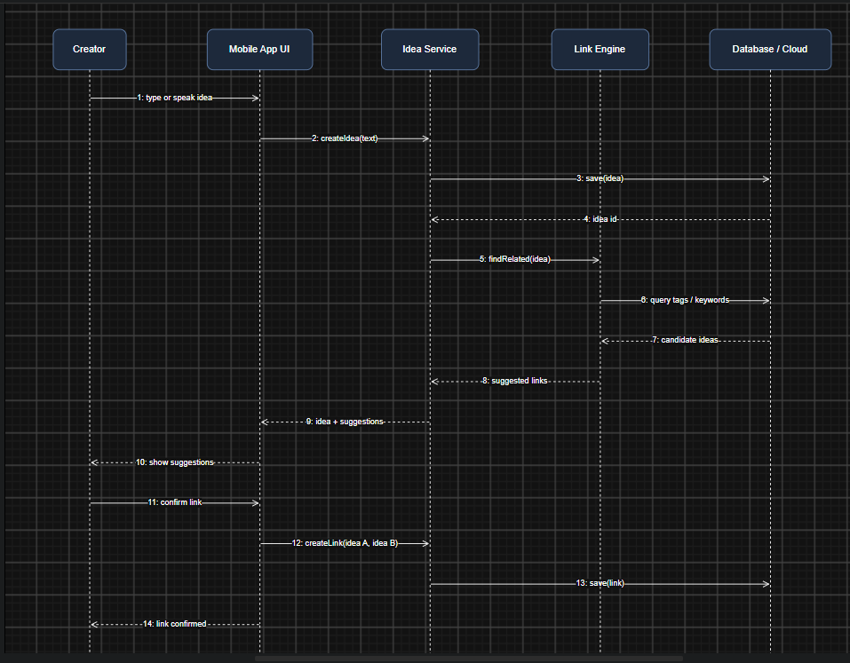

### 7.4 Data Flow Diagram: Capture and Organise
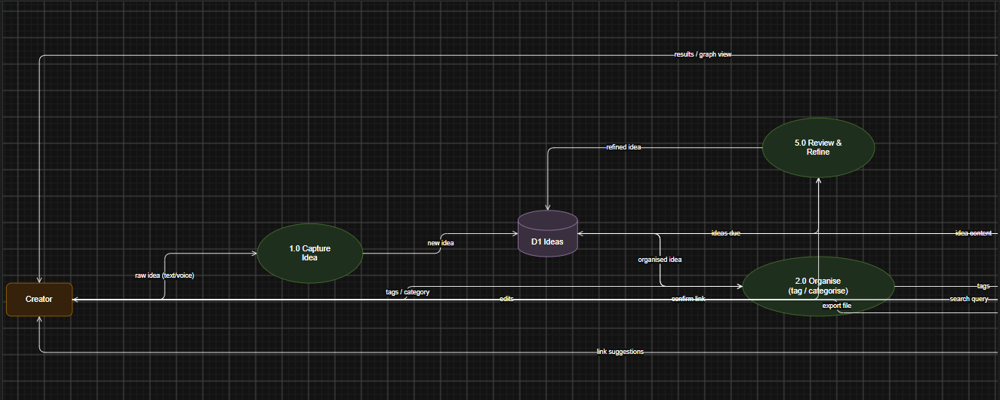

### 7.5 Data Flow Diagram: Search, Link and Export
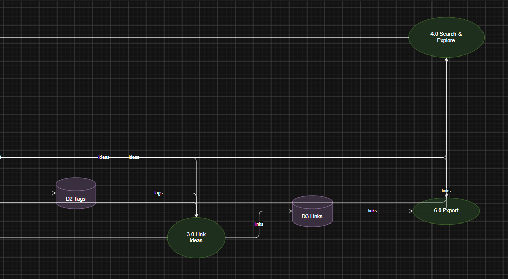

### 7.6 State Machine Diagram: Fleeting Note
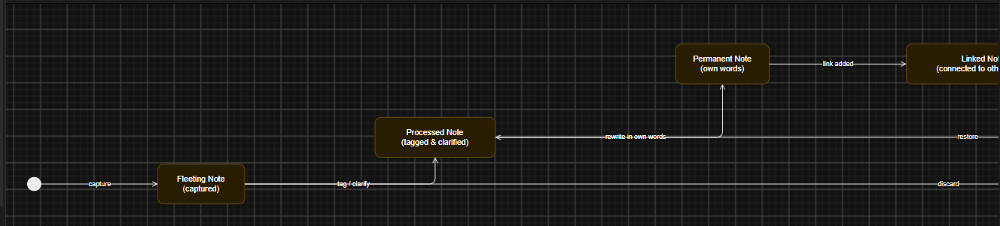

### 7.7 State Machine Diagram: Idea Life Cycle
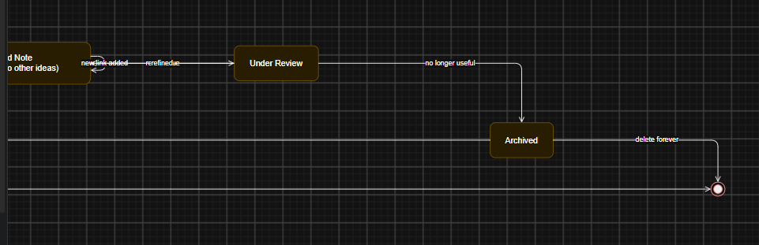

### 7.8 Class Diagram
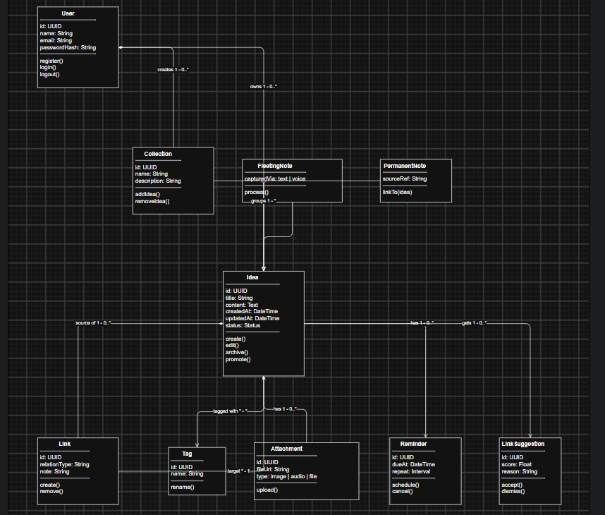

### 7.9 Model Driven Architecture (MDA) Transformation Model
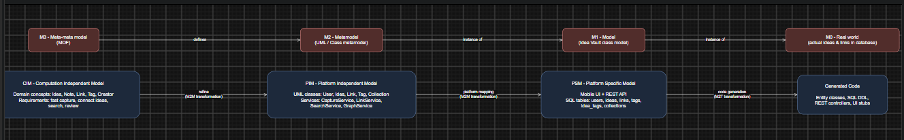

### 7.10 Version 1.0 Implementation Architecture
This shows how version 1.0 is actually built: a browser app talking to a Node.js/Express server, which stores ideas in a JSON file.

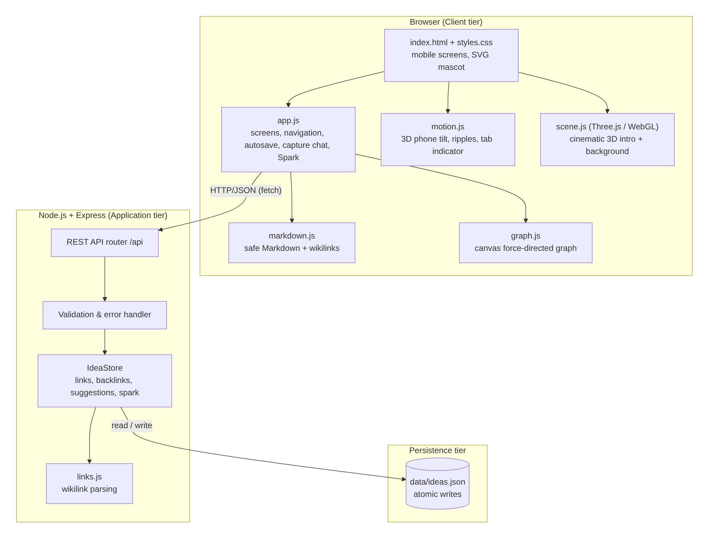

---

## 8. Data Dictionary

**Entity: Idea** (stored in `data/ideas.json` as `{ "version": 1, "ideas": [ ... ] }`)

| Field | Type | Required | Rules | Example |
|---|---|---|---|---|
| id | string (UUID v4) | auto | generated by server | `3f2b…c91` |
| title | string | yes | 1–200 chars, unique (case-insensitive), no `[` or `]`, whitespace collapsed | `Atomic notes` |
| body | string | no | ≤ 20,000 chars, Markdown, may contain `[[links]]` | `See [[Zettelkasten method]]` |
| type | enum | no (default `fleeting`) | `fleeting`, `literature`, `permanent` | `permanent` |
| tags | string[] | no | ≤ 20, each ≤ 40 chars, normalised | `["writing","knowledge"]` |
| source | string | no | ≤ 500 chars | `How to Take Smart Notes` |
| pinned | boolean | no (default false) | — | `false` |
| createdAt | string (ISO 8601) | auto | set on create | `2026-11-18T01:48:00.000Z` |
| updatedAt | string (ISO 8601) | auto | set on every change | `2026-11-18T01:50:12.000Z` |

**Derived (computed, not stored):** outgoing links, backlinks, suggestions, graph edges, tag counts, statistics.

---

## 9. Testing and Verification

### 9.1 Automated Tests

Run with `npm test` (Node.js built-in test runner). **18 tests, all passing.**

| Test file | What it covers |
|---|---|
| `tests/links.test.js` | Wikilink extraction (unique, case-insensitive, ignores empty/multi-line), link renaming, tag normalisation |
| `tests/api.test.js` | Health check; full CRUD; validation (400) and duplicate titles (409); malformed JSON; outgoing links, backlinks, missing links and graph; rename rewrites links; connection suggestions; search/tag/type filters and sorting; random (empty and non-empty); spark (never pairs linked ideas); export/import round-trip with duplicate skipping; statistics; persistence to file across restarts; static UI and security headers |

### 9.2 Manual / UI Test Cases

These were run in Chrome (desktop phone frame and 390 px phone size) using Playwright automation; no console errors were recorded.

| TC | Steps | Expected result | Result |
|---|---|---|---|
| TC-01 | First visit: enter name, tap Get Started | Home greets user by name | Pass |
| TC-02 | Tap New Idea, choose "Business idea", type idea, Send | Idea saved in Business; reply lists related ideas | Pass |
| TC-03 | Tap a "+ Connect" suggestion in the reply | Ideas linked; button shows ✓ | Pass |
| TC-04 | In an idea, type `[[Atom` and press Enter | `[[Atomic notes]]` inserted; autosaves; appears under Linked ideas | Pass |
| TC-05 | Open the linked idea | Backlink shown | Pass |
| TC-06 | My Ideas: tap "Content" chip; search "podcast" | Only matching ideas listed | Pass |
| TC-07 | Connect tab; tap a node | Graph drawn; idea opens | Pass |
| TC-08 | Tap Spark, then Create combined idea | Sheet shows 2 unlinked ideas; new "A × B" idea links to both | Pass |
| TC-09 | Tap Surprise | Random idea opens with toast | Pass |
| TC-10 | Profile: Export, then Import the same file | File downloads; import reports duplicates skipped | Pass |
| TC-11 | Body `<script>alert(1)</script>`, Preview | Shown as text, not executed | Pass |
| TC-12 | Trash icon → Delete | Confirmation sheet; idea removed | Pass |
| TC-13 | Open at 390 × 844 (phone) | Full-screen app, bottom navigation fits | Pass |
| TC-14 | Open in a new tab (WebGL forced on) | 3D intro plays, bulb lights, title shows, app swings in; background keeps orbiting | Pass |
| TC-15 | Open on a machine with software-only graphics | Intro skipped instantly, gradient background shown | Pass |
| TC-16 | Turn on "reduce motion" and open | No intro; still background; app fully usable | Pass |

Screenshots of these flows are in the `/screenshots` folder.

---

## 10. Requirements Traceability Matrix

| Requirement | User story | Implementation | Verified by |
|---|---|---|---|
| FR-1.1–1.7 | US-01 | `public/app.js` (capture screen), `store.create/_validate`, `store.suggestions` | api.test: CRUD, validation, suggestions; TC-02, TC-03 |
| FR-2.1–2.9 | US-02, US-10 | `public/app.js` (idea screen, autosave, delete sheet), `store.update/remove`, `links.normaliseTags` | api.test: CRUD; links.test: tags; TC-04, TC-12 |
| FR-3.1–3.5 | US-03 | `links.extractLinks`, `store.outgoing/backlinks`, autocomplete in `app.js` | api.test: wikilinks; links.test; TC-04, TC-05 |
| FR-3.6 | US-04 | `links.renameLinks`, `store.update` | api.test: renaming |
| FR-4.1–4.4 | US-05 | `store.suggestions`, `app.js linkCurrentTo` | api.test: suggestions; TC-03 |
| FR-5.1–5.5 | US-06 | `store.list`, My Ideas screen | api.test: filters; TC-06 |
| FR-6.1–6.4 | US-07 | `store.graph`, `public/graph.js` | api.test: graph; TC-07 |
| FR-7.1–7.2 | US-08 | `store.random`, `store.stats` | api.test: random, stats; TC-09 |
| FR-7.3–7.5 | US-11 | `store.spark`, `GET /api/spark`, Spark sheet in `app.js` | api.test: spark; TC-08 |
| FR-8.1–8.3 | US-09 | `store.exportAll/importAll`, Profile screen | api.test: export/import; TC-10 |
| FR-9.1–9.4 | US-12 | Welcome and Profile screens in `app.js` | TC-01 |
| FR-10.1–10.6 | US-13 | `client/scene.js` → `public/scene.js` (Three.js), intro styles in `styles.css`, safety net in `motion.js` | TC-14, TC-15, TC-16 |
| NFR-R1, R2 | — | `store._save` (atomic) | api.test: persistence |
| NFR-S1–S6 | — | `markdown.js` escaping, `app.js` headers & error handler | api.test: headers, malformed JSON; TC-11 |
| NFR-U5 | — | `styles.css` media queries | TC-13 |

---

## 11. Risk Management

Risks are managed with the **RMMM** approach (Risk Mitigation, Monitoring and Management). Each risk is rated for **probability** (1–5) and **impact** (1–5), and its score is probability × impact: Low 1–4, Medium 5–9, High 10–16, Critical 20–25. The full plan, with detailed RMMM for each high risk and the monitoring log, is in [`docs/Risk_Management/Risk_Management_Plan.md`](../Risk_Management/Risk_Management_Plan.md).

**Risk owners:** Ayesha Shafiq owns front-end, design, usability and documentation risks. Saveez Ali owns back-end, data, security, testing and deployment risks. Both members own schedule, team and integrity risks.

### 11.1 Risk Register (summary)

| ID | Risk | P | I | Score | Level | Key mitigation | Owner |
|---|---|---|---|---|---|---|---|
| R1 | Missing the submission deadline | 3 | 5 | 15 | High | Milestones, checklist, core features first | Both |
| R2 | Scope creep from repeated design changes | 4 | 3 | 12 | High | Test each change before the next; documents updated once at the end | Ayesha |
| R3 | Idea data lost or corrupted | 2 | 5 | 10 | High | Atomic writes, validation, JSON export backup | Saveez |
| R4 | 3D intro slow or unsupported | 3 | 3 | 9 | Medium | GPU detection, fallback background, Skip button, safety timer | Ayesha |
| R5 | XSS through idea text | 2 | 4 | 8 | Medium | HTML escaping, strict CSP, server validation | Saveez |
| R6 | Team member unavailable | 2 | 4 | 8 | Medium | Shared repo and documentation | Both |
| R7 | Library breakage or vulnerability | 2 | 3 | 6 | Medium | Pinned versions, `npm audit` (0 vulnerabilities) | Saveez |
| R8 | Misunderstood requirements | 2 | 4 | 8 | Medium | Submission checklist, traceability matrix | Ayesha |
| R9 | App fails to run on the instructor's computer | 3 | 4 | 12 | High | README, troubleshooting, standalone demo file | Saveez |
| R10 | Linking feels confusing to users | 3 | 3 | 9 | Medium | Autocomplete, suggestions, onboarding | Ayesha |
| R11 | Over-reliance on an AI assistant | 2 | 4 | 8 | Medium | Disclosed in Paid_Tools_Links.txt; all code reviewed and tested | Both |
| R12 | Source code lost | 1 | 5 | 5 | Medium | GitHub repository and backups | Both |
| R13 | Animations cause discomfort | 2 | 2 | 4 | Low | Reduce-motion support, short animations | Ayesha |
| R14 | JSON file limits large vaults | 2 | 2 | 4 | Low | Size limits; database planned as future work | Saveez |

### 11.2 Risk Matrix

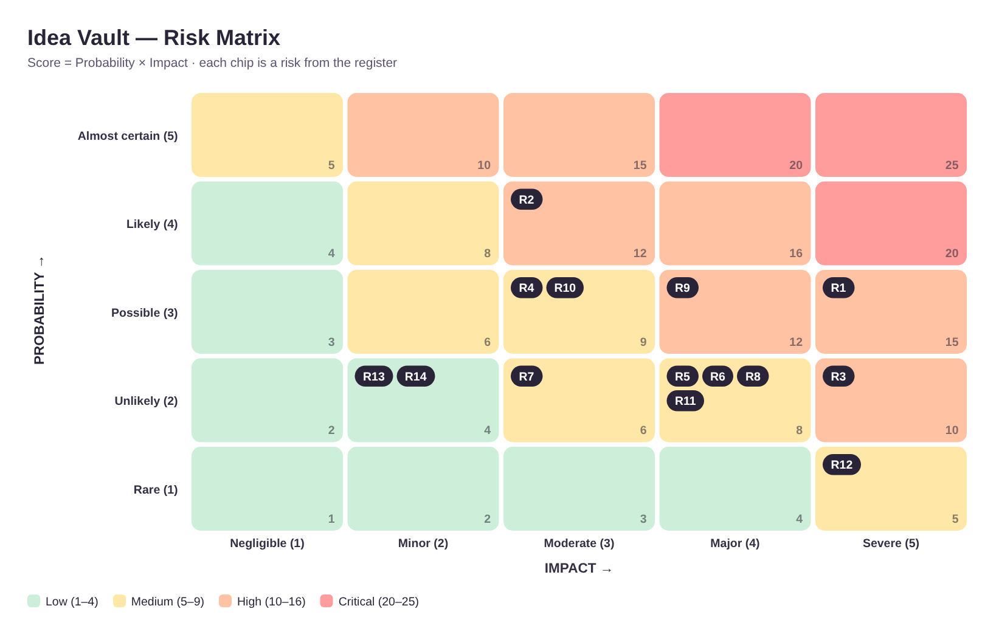

### 11.3 Risks that occurred and how they were handled
- **R2 (scope creep):** the interface was redesigned several times: mobile-style screens, animations, motion graphics, a 3D intro and a new colour theme. Each change was tested before the next, and the documents were updated once the app was final.
- **R4 (3D performance):** testing showed the 3D intro was very slow on a computer without a graphics card. Software-graphics detection, a slow-frame fallback and a safety timer were added, so the app now appears instantly on such computers.
- **R9 (setup):** the final zip was installed and tested in a clean folder (18/18 tests pass, server starts).

---

## 12. Future Enhancements

1. User accounts and cloud sync across devices.
2. Mobile app / PWA with offline capture and voice-to-text.
3. SQLite or PostgreSQL storage for very large vaults.
4. AI-assisted semantic connection suggestions (would introduce a paid API; not used in v1.0).
5. Image and file attachments inside ideas.
6. Daily "idea review" reminders by email or notification.
7. Collaborative vaults for teams.
8. Collections for grouping ideas, plus "Under Review" and "Archived" idea states (see the state machine diagrams in Section 7).
9. Export to PDF, Markdown and Notion.

---

## 13. Appendices

### Appendix A — Project Structure

```
idea-vault/
├── src/                 server code (app.js, store.js, links.js, server.js, seed.js)
├── client/              source of the 3D intro (scene.js, uses Three.js)
├── public/              front end (index.html with SVG mascot, styles.css, app.js, motion.js, markdown.js, graph.js, scene.js = bundled 3D intro)
├── tests/               automated tests
├── data/                local data file (ideas.json, git-ignored)
├── docs/SRS/            this SRS (Markdown + PDF) and diagrams
├── docs/UML/            system models by Ayesha Shafiq (context, use case, sequence, DFDs, state machines, class, MDA)
├── docs/Risk_Management/  risk management plan and risk matrix
├── docs/Tools_and_Technologies/   tools documentation and screenshots
├── screenshots/         application screenshots
├── Paid_Tools_Links.txt
└── README.md
```

### Appendix B — Paid Tools

Idea Vault itself uses no paid APIs or services: everything needed to install and run it is free and open source. The only premium service used was during development: Claude (Anthropic), an AI assistant used for code and documentation help on a paid plan. See `Paid_Tools_Links.txt`.
