# Tools and Technologies — Idea Vault

**Prepared by:** Ayesha Shafiq (F25CSC068) and Saveez Ali (F25CSC020) · **Course:** Software Engineering · **Course instructor:** Sir Umer

This document lists every tool, framework, library, platform and technology used to build, test and document **Idea Vault**, with a short description of how each one was used and a screenshot. All screenshots are in [`screenshots/`](screenshots/).

## Summary

| # | Tool / Technology | Category | Version | Cost | Used for |
|---|---|---|---|---|---|
| 1 | Node.js | Runtime | 20+ (tested on 22) | Free | Runs the back-end server and tests |
| 2 | npm | Package manager | 10.x | Free | Installs Express, runs project scripts |
| 3 | Express | Web framework | 4.x | Free (MIT) | REST API, static file serving, error handling |
| 4 | JSON file storage (Node `fs`) | Data storage | built-in | Free | Persists ideas in `data/ideas.json` |
| 5 | HTML5, CSS3, JavaScript (ES2020), SVG | Front-end languages | — | Free | Mobile-style user interface, mascot and icons |
| 6 | Canvas API | Browser API | — | Free | Interactive idea graph |
| 7 | Node.js test runner (`node:test`) | Testing | built-in | Free | 18 automated tests |
| 8 | Google Chrome + DevTools | Browser / debugging | current | Free | Running and debugging the app |
| 9 | Git | Version control | 2.x | Free | Tracking changes, commits |
| 10 | GitHub | Code hosting | — | Free plan | Hosting the repository for submission |
| 11 | Visual Studio Code | Code editor | current | Free | Writing and editing code |
| 12 | Mermaid | Diagramming | 11.x | Free (MIT) | Implementation architecture diagram |
| 13 | Playwright | UI automation | 1.x | Free (Apache-2.0) | Automated UI checks and screenshots |
| 14 | Markdown | Documentation | — | Free | README, SRS and this document |
| 15 | Three.js | 3D / WebGL library | 0.186 | Free (MIT) | Cinematic 3D intro and living background |
| 16 | esbuild | Bundler | 0.28 | Free (MIT) | Bundles Three.js + the 3D scene into one offline file |
| 17 | Claude (Anthropic) | AI assistant | — | **Paid plan** | Help with code, tests and documentation |

Only **Claude** is a paid / premium service, and it was used only during development. The application itself uses no paid service. See [`Paid_Tools_Links.txt`](../../Paid_Tools_Links.txt).

---

## 1. Node.js
**Website:** https://nodejs.org · **Category:** JavaScript runtime

**How it was used:** Node.js runs the whole back end (`src/server.js`). Built-in modules handle the core work: `fs` for atomic file saving, `crypto` for UUIDs and random idea selection, `path` for portable file paths, and `node:test` for testing. No other runtime or database is needed.

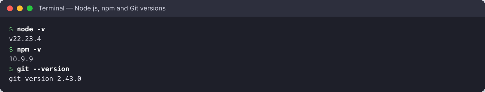

## 2. npm (Node Package Manager)
**Website:** https://www.npmjs.com · **Category:** package manager

**How it was used:** It installs the single runtime dependency (Express) and defines the project scripts in `package.json`: `npm start`, `npm run dev`, `npm run seed` and `npm test`. `package-lock.json` pins exact versions so installs are repeatable. A fresh install reports 0 vulnerabilities.

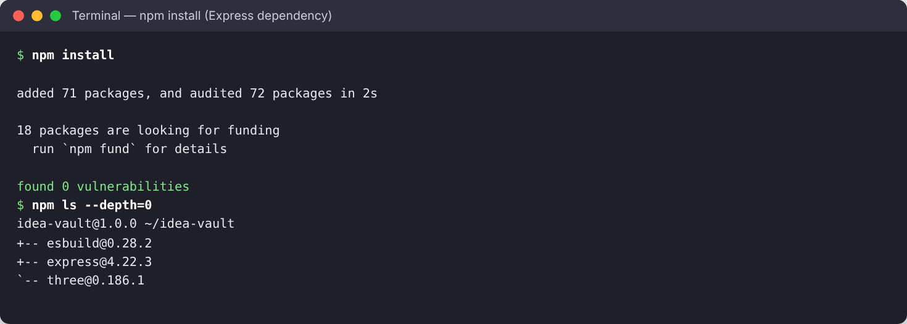

## 3. Express
**Website:** https://expressjs.com · **Category:** web framework

**How it was used:** In `src/app.js`, Express:
- defines the REST API under `/api` (ideas CRUD, tags, graph, stats, random, spark, export/import);
- parses JSON request bodies with a 2 MB limit;
- adds security headers (Content-Security-Policy, X-Frame-Options, nosniff) and disables `X-Powered-By`;
- serves the front-end files from `public/`;
- returns errors as clean JSON with the right status (400 / 404 / 409 / 500).

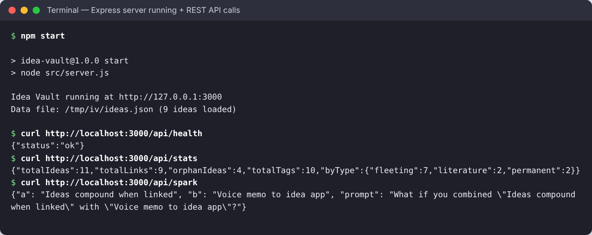

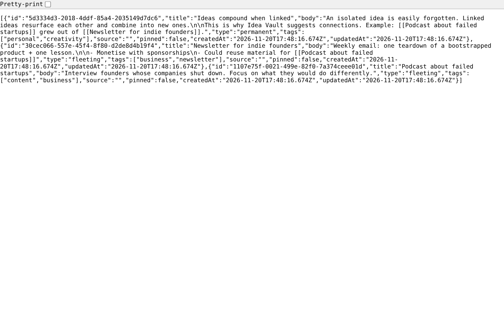

## 4. JSON File Storage (Node.js `fs`)
**Category:** data persistence

**How it was used:** `src/store.js` (class `IdeaStore`) keeps all ideas in `data/ideas.json`. Every save writes to a temporary file and then renames it, which makes the write atomic so a crash can't corrupt the data. JSON is human-readable, needs no database server, and is also the export/import format.

## 5. HTML5, CSS3, Vanilla JavaScript and SVG
**Category:** front-end technologies

**How it was used:**
- **HTML5** (`public/index.html`): the seven app screens (Welcome, Home, New Idea, My Ideas, Idea, Connect, Profile), the bottom navigation and the bottom sheet.
- **CSS3** (`public/styles.css`): the "lavender night" mobile design, using the palette #2A2438, #352F44, #5C5470 and #DBD8E3 as CSS variables, with Grid, Flexbox, gradients and rounded cards. A media query makes the app full-screen on phones and puts it in a phone frame on desktop.
- **CSS animations** (`@keyframes`, transitions): screens slide in, cards pop in one after another, and the hero card shimmers. The + button has a breathing ring and buttons bounce when tapped. The chat shows typing dots, saving an idea bursts confetti, and Spark cards fly in. Everything switches off with the "reduce motion" setting.
- **SVG**: the mascot "Vaulty" (an original lightbulb robot) and every icon are drawn as inline SVG symbols. They stay sharp at any size and need no image files. The mascot is animated with SVG `<animate>`: it blinks, waves, smiles, its star twinkles and its glow pulses.
- **JavaScript** (`public/app.js`):
  - screen navigation
  - the chat-style capture screen
  - autosave and the `[[` link autocomplete
  - the Spark and delete sheets
  - the animation helpers (staggered pop-in, count-up numbers, confetti)
- **`public/motion.js`** is the motion-graphics layer. It runs:
  - the headline reveal and the 3D phone tilt with glare, smoothed every animation frame
  - a safety net that always shows the app if the 3D intro can't run
  - the parallax glass badges
  - 3D card tilt, tap ripples and the sliding tab indicator
  - the glass header that appears when you scroll

  These effects were inspired by motion-design mockup tools, and all of them were built from scratch with no animation library.
  - talking to the API with `fetch`
- **`public/markdown.js`** is a small Markdown renderer written for this project. It HTML-escapes all text first to prevent XSS.

No external frameworks, fonts or CDNs are used, so the app works offline and meets a strict Content Security Policy.

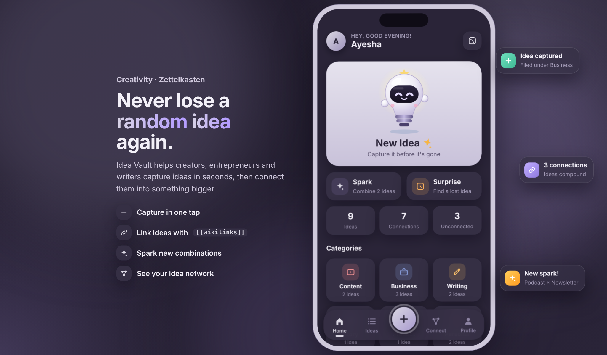

## 6. Canvas API
**Category:** browser graphics API

**How it was used:** On the **Connect** tab, `public/graph.js` implements a force-directed graph layout from scratch (repulsion between nodes, spring force along links, centring) and draws it on an HTML `<canvas>`. Node colour shows idea type and node size grows with connections. Nodes can be dragged or clicked to open an idea.

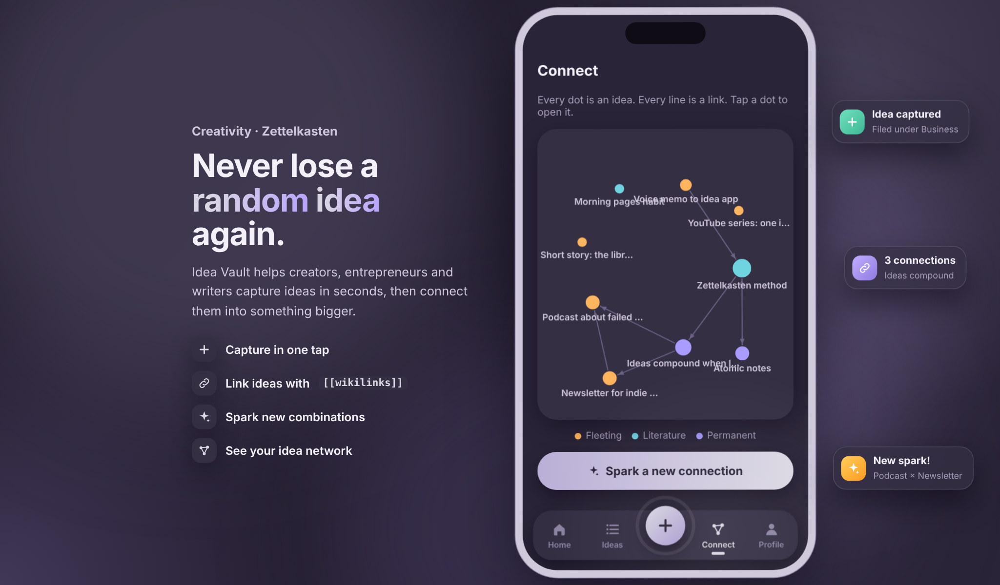

## 7. Node.js Test Runner (`node:test`)
**Website:** https://nodejs.org/api/test.html · **Category:** testing

**How it was used:** `tests/api.test.js` starts the real Express app on a random port with an in-memory store and calls every endpoint with `fetch`. `tests/links.test.js` unit-tests the wikilink helpers. Run them with `npm test`: **18 tests, all passing**.

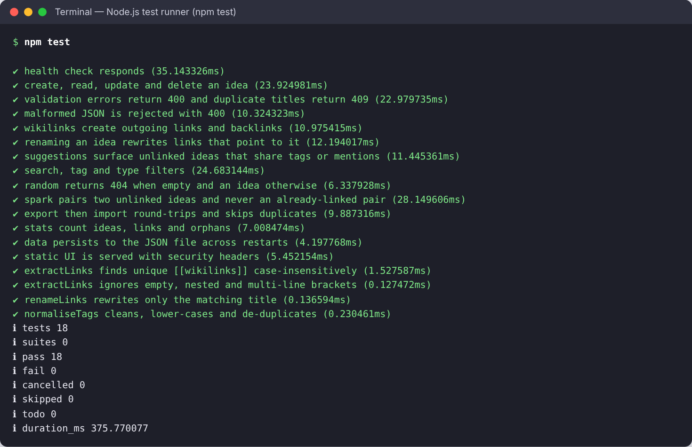

## 8. Google Chrome and DevTools
**Website:** https://www.google.com/chrome · **Category:** browser / debugging

**How it was used:** Chrome was the main browser for running and testing the UI. DevTools was used to check the Console for errors, inspect network requests to `/api`, verify the security headers, and test the phone layout in device mode (390 × 844 px).

## 9. Git
**Website:** https://git-scm.com · **Category:** version control

**How it was used:** Git tracks every change to the project. `.gitignore` keeps `node_modules/`, the personal data file `data/ideas.json` and any `.env` file out of the repository, so no personal data or secrets get uploaded.

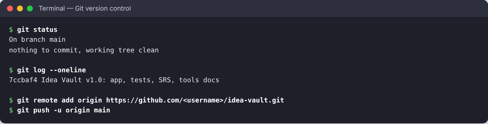

## 10. GitHub
**Website:** https://github.com · **Category:** code hosting

**How it was used:** It hosts the public repository submitted to the instructor. GitHub renders `README.md`, the SRS (Markdown), the UML document and the Mermaid diagrams directly in the browser.

> 📸 **Screenshot to add:** `screenshots/11_github_repository.png`, a screenshot of your repository page on GitHub after pushing.

## 11. Visual Studio Code
**Website:** https://code.visualstudio.com · **Category:** code editor

**How it was used:** It was used to write and edit all source code and documentation. Its built-in terminal ran `npm` and `git` commands, and Markdown preview was used to check the README and SRS.

> 📸 **Screenshot to add:** `screenshots/12_vscode_project.png`, VS Code with the `idea-vault` folder open.

## 12. Mermaid
**Website:** https://mermaid.js.org · **Category:** diagrams-as-code

**How it was used:** The version 1.0 implementation architecture diagram (SRS §7.10) is written as text in `docs/SRS/diagrams/02_architecture.mmd` and rendered to PNG and SVG. Because it is text, it is version-controlled and easy to update. The other system models in `docs/UML/` were drawn by Ayesha Shafiq.

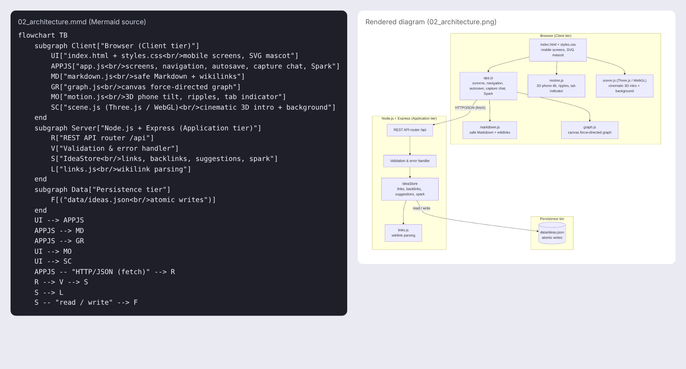

## 13. Playwright
**Website:** https://playwright.dev · **Category:** browser automation

**How it was used:** Playwright drove headless Chrome through the real UI:
- welcome, New Idea capture and the suggested connections
- link autocomplete and preview
- category filters and search
- the Connect graph and Spark
- profile, export/import, the XSS check and delete confirmation

It also took the application screenshots in `/screenshots`, rendered the diagrams and produced the SRS PDF. It is a development tool only and is not needed to run the app.

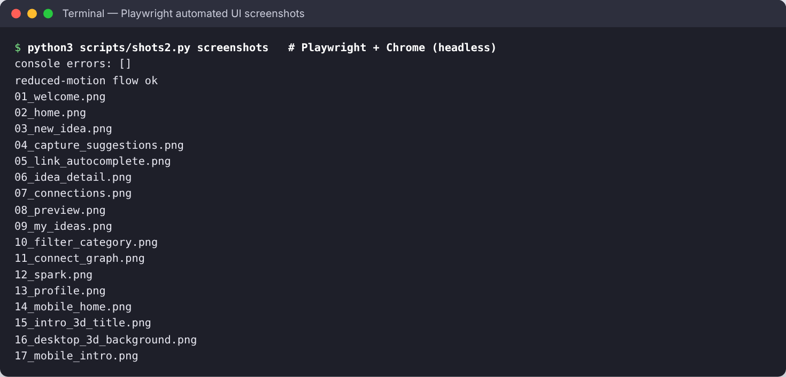

## 14. Markdown
**Category:** documentation format

**How it was used:** The README, the SRS (`docs/SRS/IdeaVault_SRS.md`, also exported to PDF) and this document are written in Markdown, which GitHub renders automatically.

## 15. Three.js (WebGL)
**Website:** https://threejs.org · **Category:** 3D graphics library

**How it was used:** `client/scene.js` uses Three.js to build the cinematic 3D intro and background. It includes:
- a printed "idea chart" texture (IDEA, SPARK, LINKS, CONNECT…) drawn on a canvas
- glass lightbulbs made with lathe geometry, reflective metal bases and filaments that glow
- Zettelkasten index cards joined by a thread
- soft shadows, studio reflections (`RoomEnvironment`), fog and a warm light that switches on

A camera path (Catmull-Rom curves) creates the fly-over, and the scene then orbits slowly with mouse parallax. The intro is skipped automatically on computers without 3D graphics, and with "reduce motion" on it shows a still frame.

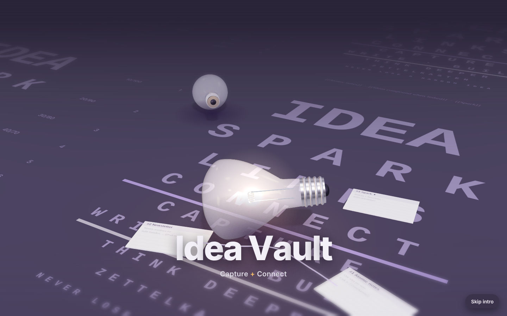

## 16. esbuild
**Website:** https://esbuild.github.io · **Category:** JavaScript bundler

**How it was used:** `npm run build:scene` bundles `client/scene.js` and the parts of Three.js it uses into a single minified file, `public/scene.js` (about 570 KB). The app can then load it from its own server with no CDN, so it works offline and keeps the strict Content Security Policy. The built file is included, so you don't need to run the build to start the app.

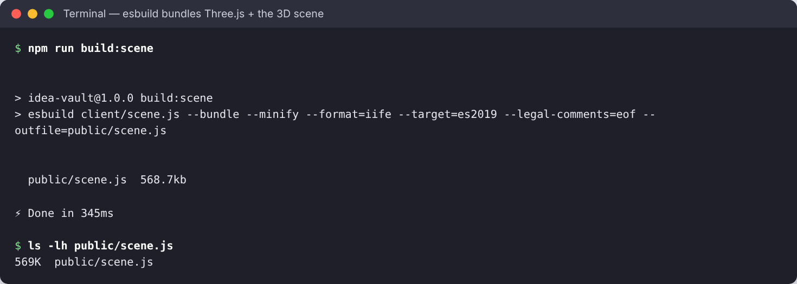

## 17. Claude (Anthropic) — *Paid / Premium*
**Website:** https://claude.ai · **Category:** AI assistant

**How it was used:** It was an AI assistant during development, used to help write and review source code and tests and to draft the README, SRS and diagrams. All output was run, tested and reviewed. The application does **not** call any AI API and needs no API key. Details are in [`Paid_Tools_Links.txt`](../../Paid_Tools_Links.txt).
