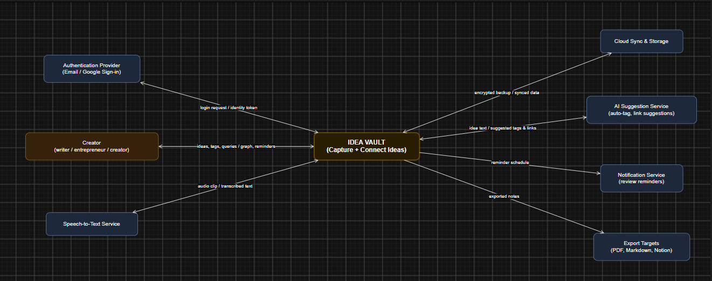
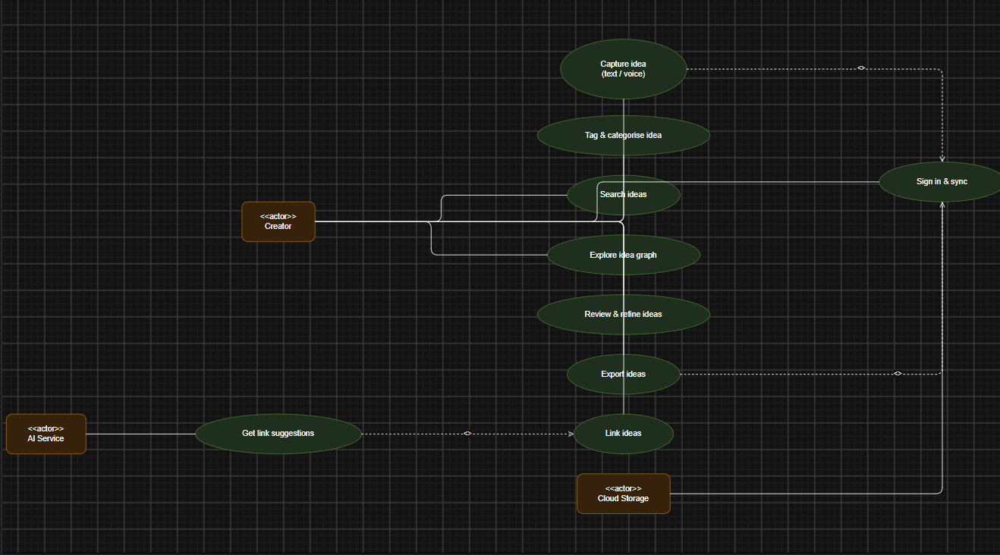
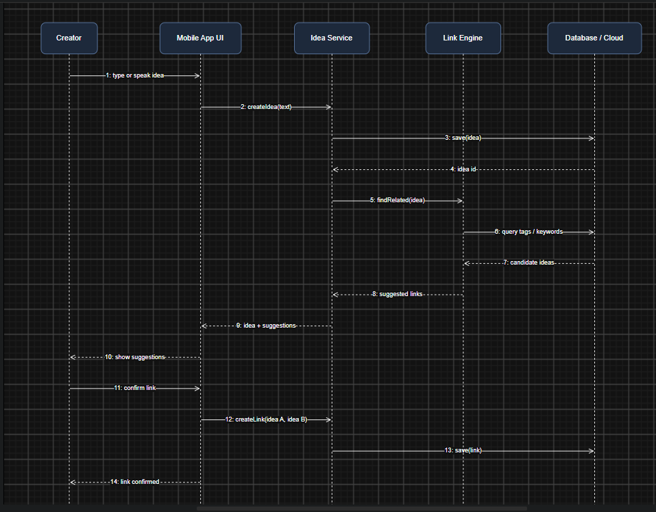
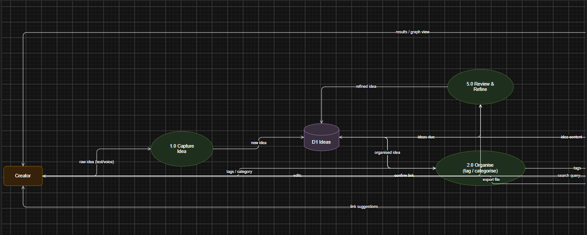
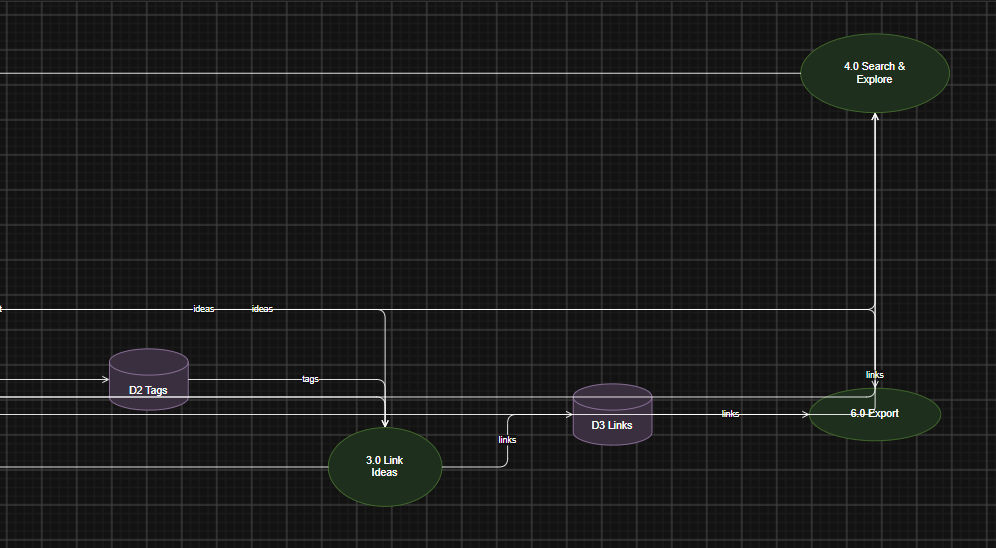
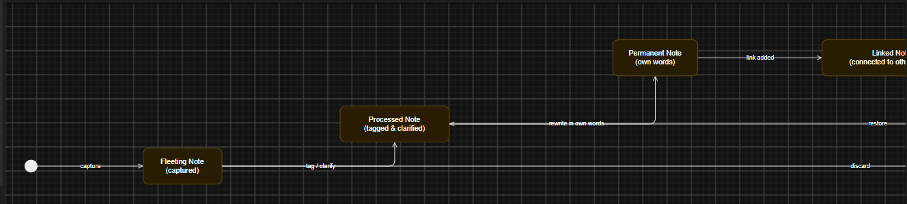
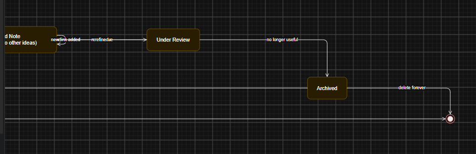
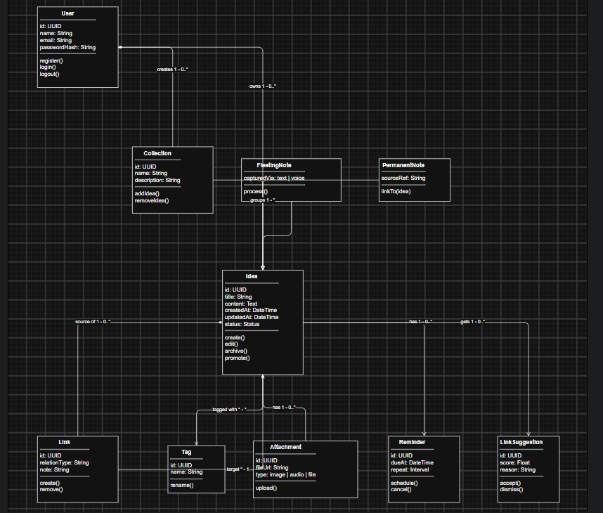
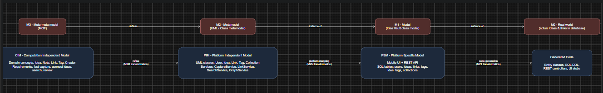

# Idea Vault — System Models (UML)

**Prepared by:** Ayesha Shafiq (F25CSC068) and Saveez Ali (F25CSC020) · **Course:** Software Engineering · **Course instructor:** Sir Umer

These system models were drawn by **Ayesha Shafiq**. The original file is [`Ayesha_Shafiq_Idea_Vault_Models.pdf`](Ayesha_Shafiq_Idea_Vault_Models.pdf).

| # | Diagram | Type |
|---|---|---|
| 1 | System context diagram | Context model |
| 2 | Use case diagram | UML (behavioural) |
| 3 | Sequence diagram | UML (interaction) |
| 4 | Data flow diagram: capture and organise | Data flow (DFD) |
| 5 | Data flow diagram: search, link and export | Data flow (DFD) |
| 6 | State machine diagram: fleeting note | UML (behavioural) |
| 7 | State machine diagram: idea life cycle | UML (behavioural) |
| 8 | Class diagram | UML (structural) |
| 9 | Model Driven Architecture (MDA) transformation model | MDA |

---

## 1. System Context Diagram
Idea Vault sits at the centre. The **Creator** (writer, entrepreneur or creator) sends ideas, tags, queries and graph requests, and receives reminders. The diagram also shows the external systems in the full design:

| External system | What it exchanges with Idea Vault |
|---|---|
| Authentication Provider (email / Google sign-in) | Login request and identity token |
| Speech-to-Text Service | Audio clip and transcribed text |
| Cloud Sync & Storage | Encrypted backup and synced data |
| AI Suggestion Service | Idea text, and suggested tags and links |
| Notification Service | Reminder schedule |
| Export Targets (PDF, Markdown, Notion) | Exported notes |

## 2. Use Case Diagram
**Actors:**
- **Creator:** the primary actor.
- **AI Service** and **Cloud Storage:** secondary actors.

**Use cases:** capture idea (text / voice), tag and categorise idea, search ideas, explore idea graph, review and refine ideas, export ideas, link ideas, get link suggestions, and sign in and sync.

**Relationships:** «include» / «extend» links connect *Get link suggestions* to *Link ideas*, and *Capture idea* and *Export ideas* to *Sign in & sync*.

## 3. Sequence Diagram: Capture an Idea and Link It
**Lifelines:** Creator, Mobile App UI, Idea Service, Link Engine, Database / Cloud.

**Messages:**
1. The Creator types or speaks an idea.
2. The UI calls `createIdea(text)`, and the service saves the idea and gets its id back.
3. The **Link Engine** runs `findRelated(idea)`, queries tags and keywords, and returns candidate ideas as suggested links.
4. The UI shows the suggestions.
5. The Creator confirms one, which calls `createLink(ideaA, ideaB)` and saves the link.
6. The UI confirms the link.

## 4. Data Flow Diagram: Capture and Organise
**Processes:**
- **1.0 Capture Idea:** the raw idea (text or voice) becomes a new idea in **D1 Ideas**.
- **2.0 Organise (tag / categorise):** produces organised ideas, tags and categories.
- **5.0 Review & Refine:** writes refined ideas back to D1.

The Creator receives results and the graph view, link suggestions and the export file. The Creator sends edits, link confirmations and search queries.

## 5. Data Flow Diagram: Search, Link and Export
**Processes:**
- **3.0 Link Ideas:** reads ideas and tags and writes to **D3 Links**.
- **4.0 Search & Explore:** uses ideas, tags and links.
- **6.0 Export:** combines ideas and links into an export file.

**D2 Tags** stores the categories.

## 6. State Machine Diagram: Fleeting Note
The note moves through these states:
1. **Fleeting Note (captured)**
2. *tag / clarify* → **Processed Note (tagged & clarified)**
3. *rewrite in own words* → **Permanent Note (own words)**
4. *link added* → **Linked Note (connected to other ideas)**

A note can be *discarded*, and a discarded note can be *restored*.

## 7. State Machine Diagram: Idea Life Cycle
A linked note stays linked when a *new link is added* (self-transition). Over time:
1. *re-refine* → **Under Review**
2. *no longer useful* → **Archived**
3. *delete forever* → the final state

## 8. Class Diagram
**Central class:** **Idea** (id, title, content, createdAt, updatedAt, status; `create()`, `edit()`, `archive()`, `promote()`).

**Related classes:**
- **User** (register / login / logout) owns ideas and creates **Collections**, which group ideas.
- **FleetingNote** and **PermanentNote** are kinds of idea.
- Each idea has **Links** (relationType, note), **Tags**, **Attachments** (image, audio or file), **Reminders** and **LinkSuggestions** (score, reason; `accept()`, `dismiss()`).

## 9. Model Driven Architecture (MDA) Transformation Model
**Top row:** the four OMG metamodelling layers.
- **M3** meta-meta model (MOF) *defines* **M2** metamodel (UML).
- **M1**, the Idea Vault class model, is an *instance of* M2.
- **M0**, the real ideas and links in the database, is an *instance of* M1.

**Bottom row:** the MDA transformation chain.
1. **CIM** (domain concepts and requirements) → *refine (M2M)* → **PIM** (UML classes and services)
2. **PIM** → *platform mapping (M2M)* → **PSM** (mobile UI, REST API, SQL tables)
3. **PSM** → *code generation (M2T)* → generated code

---

## Design Model vs. Version 1.0 Implementation

These models show the **complete design vision** of Idea Vault. Version 1.0 implements the core **Capture + Connect** features. The rest are planned as future work (SRS Section 12, Future Enhancements).

| Element in the models | Status in version 1.0 | How version 1.0 does it |
|---|---|---|
| Capture idea (text) | ✅ Implemented | Chat-style **New Idea** screen |
| Capture idea (voice), Speech-to-Text Service | 🔜 Planned | Future: voice-to-text capture |
| Tag & categorise idea, D2 Tags, Tag class | ✅ Implemented | 6 categories + extra tags |
| Link ideas, D3 Links, Link class | ✅ Implemented | `[[wikilinks]]` with autocomplete, backlinks |
| Get link suggestions, LinkSuggestion class | ✅ Implemented (rule-based) | Suggestions from shared tags and mentions; one-tap Connect |
| AI Suggestion Service | 🔜 Planned | Future: AI-based semantic suggestions |
| Search ideas, explore idea graph (4.0) | ✅ Implemented | Search, filters, **Connect** graph |
| Review & refine ideas (5.0), Fleeting → Permanent | ✅ Implemented | Types Fleeting / Literature / Permanent; Surprise and Spark resurface ideas |
| Export ideas (6.0) | ✅ Implemented (JSON) | Export / import on the Profile screen |
| Export to PDF / Markdown / Notion | 🔜 Planned | Future export formats |
| Sign in & sync, User class, Authentication Provider, Cloud Sync | 🔜 Planned | v1.0 is single-user and stores data locally in `data/ideas.json` |
| Reminders, Notification Service | 🔜 Planned | Future: review reminders |
| Attachments | 🔜 Planned | Future: images, audio and files |
| Collections | 🔜 Planned | Categories group ideas in v1.0 |
| States *Under Review* and *Archived* | 🔜 Planned | v1.0 supports delete; archive is future work |
| PSM: SQL tables | 🔜 Planned | v1.0 uses a JSON file; SQL database is future work |
